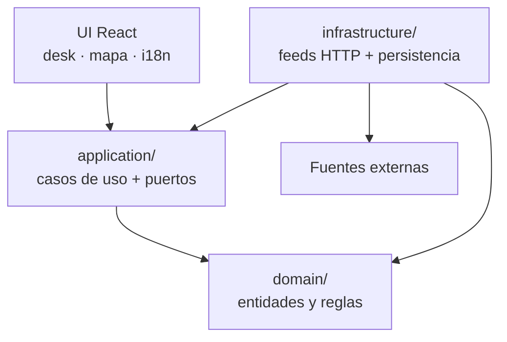
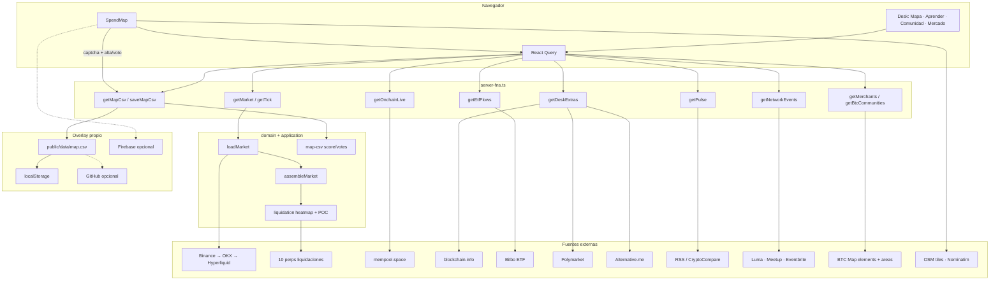
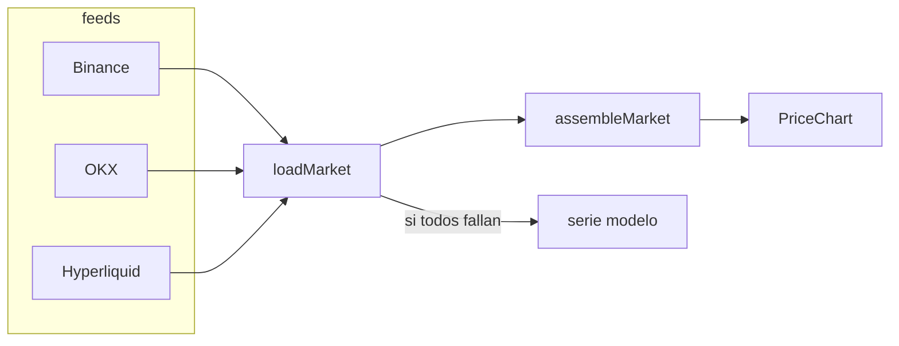
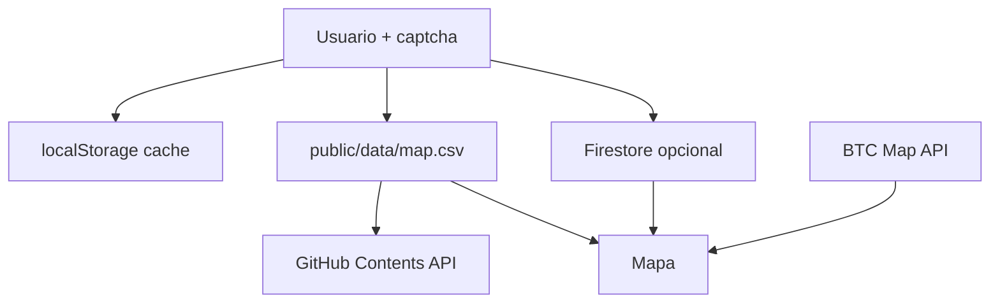

# bitacora.btc — arquitectura vigente

Informe al 15 oct 2026. Describe lo que el código hace hoy, no un plan.

**Producto.** Desk público de Bitcoin en cuatro salas: **Mapa**, **Aprender**, **Comunidad** y **Mercado**. La casa abre en el globo (sala Mapa). El gráfico de precio es SVG propio (`bit-stage`), no Recharts. Frase: *el nodo que te une al mundo Bitcoin*. Iniciativa Consciencia Bitcoin By LCM.

**Auth.** Apagada (`VITE_AUTH_ENABLED=false`). No hay cuentas. Postgres/Better Auth están en el scaffold y no se usan.

---

## 1. Superficies

| Ruta | UI | Qué muestra |
|---|---|---|
| `/` | `Desk` | Cuatro salas. Sin hash, abre la sala **llegar**: el globo y, en el mismo scroll, Aprender. No abre en Mercado. |
| `/#mapa` | globo | Sala Mapa. «Entrar al mapa» pasa a Leaflet. |
| `/#aprender` | hub | Conciencia, historia, pulso y minado. |
| `/#comunidad` | hub | Anuncios, eventos, experiencias y el feed. |
| `/#mercado` | hub | Velas, EMAs, heatmap, ETF y la Red. El precio se pide al entrar a esta sala. |
| `/mapa` | `SpendMap` | Página propia del mapa: Leaflet + BTC Map + comunidades federadas + overlay propio. |
| `/legal` | textos | Aviso, privacidad, cookies, accesibilidad y términos. |

Barra: Mapa · Aprender · Comunidad · Mercado. Sumate es un enlace a Telegram, no una quinta sala. Idioma: ES / PT / EN (`useLocale` + `i18n.ts`).

---

## 2. Capas (clean architecture)

- **`domain/`** — tipos (`MarketPayload`, `OnchainPayload`, `EtfFlowPayload`, `MerchantLocal`, `Community`, `NetworkEvent`) y reglas: velas/EMA, liquidaciones, calificación 1–5, horarios CSV, recuadro de mapa (`boxAround` / `CityFrame`), serie sintética (fixture determinista).
- **`application/`** — `loadMarket`, `loadExtras`, `assembleMarket`, `buildModelMarket`. Puertos: `MarketFeed`, `ExtrasFeed`, `LoadLiqBlend`, `ModelMarket`.
- **`infrastructure/`** — adaptadores: klines, liquidaciones, mempool, Bitbo ETF, BTC Map, Luma/Meetup/Eventbrite, CSV, Firebase opcional. Disco: `last-known.server.ts` (suffix `.server` para no entrar al bundle). `server-fns.ts` es el único borde hacia la UI.
- **`components/`** — presentación. Habla con el servidor vía `server-fns.ts` + React Query. El fallback de mercado (`buildModelMarket`) entra por `application/`, no por feeds.

El servidor de TanStack Start (`createServerFn`) es el borde: el browser no pega a Binance/BTC Map en crudo para el desk; el mapa sí usa Leaflet/OSM en cliente.

---

## 2.1 Flujo de datos (punta a punta)

**Lectura.** El desk pide payloads ya armados. Fallbacks: si Binance cae, OKX; si todo cae, serie modelo. BTC Map no se copia: se consulta.

**Escritura (solo mapa).** Captcha → `saveMapCsv` mergea por `id` → CSV. El resto de la app es de solo lectura.

**Ritmos.** Tick ~2 s · on-chain ~6 s · mercado al entrar a `#mercado` · ETF ~15 min · BTC Map 6 h · eventos 5 min.

---

## 3. Mercado — flujo de datos

1. **Velas.** Orden: Binance → OKX → Hyperliquid → modelo sintético. Intervalo fijo 1D / 1S / 1M / 6M (`resampleToTf`). El paneo no cambia la estructura de la vela.
2. **Tick.** Precio ~2 s (`getTick`).
3. **Liquidaciones.** Promedio de 10 perps (Binance, OKX, Bybit, Bitget, Hyperliquid, Gate, KuCoin, HTX, MEXC, Kraken). Kernel gaussiano; POC semanal = 52 velas 1S, **no** sigue el zoom.
4. **On-chain vivo (~6 s).** mempool.space: bloque, hashrate, fee, mempool, retarget.
5. **On-chain histórico.** blockchain.info charts.
6. **ETF spot.** Bitbo (`bitbo.io/treasuries/etf-flows/`): neto USD de la última sesión, 5d, ~30d, desglose IBIT/FBTC/GBTC… Verde = ingreso, rojo = egreso. Cache ~15 min. No es mempool: es capital de ETF al contado.
7. **Extras.** Polymarket (Clarity), Alternative.me (miedo/codicia), OKX libro (liquidez), RSS/CryptoCompare (pulso).

---

## 4. Mapa — federación + overlay

**Principio:** no clonar BTC Map. Hay ~25k comercios y ~690 comunidades vivas. Se **leen** en vivo; bitacora solo guarda lo propio.

| Capa | Fuente | Persistencia |
|---|---|---|
| Comercios mundiales | `api.btcmap.org/v2/elements` | ninguna (TTL 6 h en servidor) |
| Comunidades mundiales | `api.btcmap.org/v2/areas` `type=community` | ninguna |
| Overlay usuario | votos `score`/`votes`, propuestas, comunidades nuevas, horarios, logo URL, redes | CSV + localStorage (+ Firebase/GitHub si hay config) |

**CSV** (`public/data/map.csv`), headers en inglés:

`id,tipo,name,lat,lon,address,description,notes,score,votes,logo,socials,hours,pays,created`

- `tipo`: `shop` \| `community`
- Estrellas **solo comercios**: un id vota una vez por envío. El promedio solo cambia si el número que llega es el de sumar una estrella (1 a 5). Un salto de más de un voto no toca la fila.
- Horarios compactos: `lun0800120014001900mar…` (huecos = `0`).
- Logo: **URL https**, no archivo.
- Un id no vota dos veces en el mismo envío.

**Escritura.** Captcha → `saveMapCsv` (merge por `id` en disco). Opcional: commit GitHub si hay `GITHUB_TOKEN`; Firestore si hay `VITE_FIREBASE_*`. Sin eso: este dispositivo + archivo local.

**Geo.** IP (GeoJS) → recuadro Nominatim; GPS al tocar el botón naranja. Autocomplete Photon/Nominatim solo al cargar un comercio nuevo.

**Confianza comunidades propias.** `communityTrust` (redes + promedio). Badge: estrella naranja ₿.

---

## 5. Comunidad y networking

Agregador de eventos Bitcoin (solo futuros, sin duplicar):

- Luma (varias queries)
- Meetup GraphQL (hubs)
- Eventbrite (búsqueda destino)

Filtros: cerca de ti (país GPS/IP), continente+país en un menú, plataforma (botones naranja), tipo (meetup/conf/taller/…). Online muestra hora UTC en badge naranja.

---

## 6. Persistencia — mapa de decisiones

| Store | Qué | Escala |
|---|---|---|
| BTC Map API | pines mundiales | la correcta |
| CSV en repo | overlay chico | ok cientos de filas; no 25k |
| Firebase | sync multi-dispositivo | listo, apagado sin claves |
| localStorage | caché / offline | por navegador |

---

## 7. Server functions

`src/infrastructure/server-fns.ts` — POST, sin `userId` (auth off):

`getMarket`, `getDeskExtras`, `getTick`, `getOnchainLive`, `getEtfFlows`, `getPulse`, `getMerchants`, `getBtcCommunities`, `searchMap`, `getNetworkEvents`, `getCommunityFeed`, `getCityFrame`, `searchAddress`, `getMapCsv`, `saveMapCsv`.

---

## 8. Stack

- React 19, Vite, TanStack Start / Router / Query
- Tailwind 4, Leaflet, SVG propio del gráfico (`bit-stage`). No hay Recharts.
- i18n casero ES/PT/EN
- PWA de primera parte (`/manifest.webmanifest`). El de `/__grok/` no se suma si la página ya tiene uno.
- Repo: [prezpablo/bitacora.btc](https://github.com/prezpablo/bitacora.btc)

---

## 9. Límites actuales (honesto)

1. Overlay CSV **last-write-wins** en el archivo entero.
2. Firebase y push a GitHub no corren hasta cargar claves/token.
3. ETF depende del HTML de Bitbo (si cambia el markup, el parser falla).
4. Eventos: cobertura de 3 plataformas, no las 10 teóricas; filtros geo por país/continente, no radio km.
5. Auth/DB del scaffold no forman parte del producto.

---

## 10. Dónde tocar qué

| Cambio | Sitio |
|---|---|
| Regla de velas / POC / EMA | `domain/ohlc.ts`, `market-math.ts`, `liquidation.ts` |
| Nuevo feed de mercado | `MarketFeed` + `compose.ts` |
| Nuevo extra (Clarity, ETF…) | `extra-feeds.ts` + panel en `desk.tsx` |
| Mapa BTC Map | `btc-map.ts` |
| Formato CSV / estrellas | `domain/map-csv.ts` |
| Copy UI | `lib/i18n.ts` (las 3 lenguas) |
