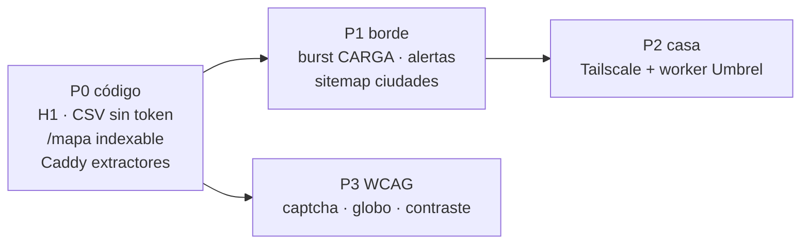

# Deuda del plan híbrido — Bitácora.btc

**Origen:** Plan de Mitigación y Optimización Híbrida (sep 2026).  
**Cotejado con:** código en `main` + Caddy en Njalla.  
**No es** un ticket de compra de dominio ni un diseño de Umbrel: es la cola para no implementar el PDF al pie de la letra.

El plan redactó Nginx, `nip.io` y bloqueo de GPTBot. El sitio **ya no es eso**. Copiar el PDF sin adaptar rompería AEO y el proxy real.

---

## 0. Qué es cierto hoy (no inventar)

| El plan dice | En el código / VPS |
|---|---|
| Staging `nip.io` | Caddy ya redirige `nip.io` y `sslip.io` → **`https://bitacorabtc.org`**. Canónica en `seo.ts` = `.org`. |
| Adquirir TLD `.org` / `.lat` | **`.org` ya está** (`bitacorabtc.org` + `www` → apex). `.lat` no hace falta. |
| H1 expone «itacora» | El ₿ tapa la B (`text-transparent`). El DOM tenía una B invisible; crawlers que ignoran color transparente leen «itácora». |
| Falta JSON-LD FAQPage + Organization | **Ya está** en el primer byte (`__root.tsx`) y en cliente (`seo-head.tsx`). |
| CSV GitHub con PII | No hay mails ni teléfonos. **Sí hay tokens `CARGA-` / `BIT-`** en `public/data/*.csv` (secreto de verificación, no PII). |
| localStorage con consentimiento | **Hecho (P0 legal).** Banner + extras. Sin cookies de ads. |
| WCAG 2.2 AA | Skip-link **existe**. Captcha, globo, contraste: abiertos. El clausulado mentía «no hay skip-link». |
| Nginx + `return 444` | El borde es **Caddy**, no Nginx. No hay `limit_req_zone`. |
| Bloquear GPTBot / Anthropic | `robots.txt` los **permite** a propósito (AEO). El mismo plan pide Featured Snippets + IA. |
| Rate-limit `/api/validar` 1 r/s | No hay esa ruta. Verificar CARGA es `createServerFn` con tope **12/h por IP** + 80/h global. |
| Worker VPS → Umbrel por VPN | **No existe.** Q1 abierto. El desk usa APIs públicas (mempool, BTC Map, etc.). |
| Cron Telegram 444/429 | **No existe.** Caddy loguea stdout. No hay bot token en el repo. |

**No construir:** Nginx al lado de Caddy, CMP de ads, bloqueo de GPTBot/Claude/Perplexity, Redis solo para este tráfico, ni un túnel Umbrel inventado.

---

## Prioridades

---

## P0 — se cierra en el repo (esta tanda)

Crawlers y visitantes ven hoy una marca partida, un CSV con códigos CARGA y un `/mapa` que redirige al hash.

| ID | Deuda | Dónde | Qué hacer |
|---|---|---|---|
| H0.1 | H1 semántico «Bitácora.btc» | `brand-mark.tsx` | **Hecho:** `sr-only` con el nombre completo; el ₿ queda `aria-hidden`. |
| H0.2 | JSON-LD FAQ + Organization | `__root.tsx`, `seo.ts` | **Ya estaba.** No duplicar. |
| H0.3 | Canónica `.org`, adiós staging | Caddy + `seo.ts` | **Ya estaba** el redirect. Docs del plan hablaban de `nip.io`; no tocar DNS. |
| H0.4 | `/mapa` como URL real | `routes/mapa.tsx`, sitemap | **Hecho:** página propia + entrada en sitemap. Google no indexa `#mapa`. |
| H0.5 | CSV público sin secretos | `map-csv.ts`, `pins-io.ts`, `public/data/*` | **Hecho:** el snapshot GitHub y el GET del mapa salen **sin** `token`. SQLite los guarda. |
| H0.6 | Skip-link declarado | `legal-eu.ts` | **Hecho:** el texto ya no dice que no existe. |
| H0.7 | Extractores, no AEO | `deploy/Caddyfile` | **Hecho:** `abort` a CCBot/Bytespider/etc. **No** se toca GPTBot, Claude, Perplexity, Google. |
| H0.8 | `<main>` anidado | `routes/index.tsx` | **Hecho:** un solo `main#contenido`. |

---

## P1 — borde y SEO (siguiente tanda)

| ID | Deuda | Dónde | Notas |
|---|---|---|---|
| H1.1 | Burst en verificar CARGA | `server-fns.ts` | **Hecho en esta tanda:** 5 hits / 5 s además del tope horario. Equivale al `burst=5` del PDF, en Node, no en Nginx. |
| H1.2 | Alertas 403/429 → Telegram | `deploy/watch-caddy-alerts.sh` | Script listo. Falta `TELEGRAM_BOT_TOKEN` + `CHAT_ID` en el VPS (no van al git). |
| H1.3 | Title/description por ruta | `seo-head.tsx` | **Hecho:** `/mapa`, `/legal`, `/labif` no reusan el title del home. |
| H1.4 | Sitemap de ciudades | `sitemap.xml` | Cuando haya ≥ 3 pines por ciudad. Hoy no inflar URLs vacías. |
| H1.5 | Tokens solo al dueño | pines + mapa | Pines: el tablero público ya no trae `token` (queda en session del que cargó). Mapa: el código CARGA solo se muestra si está en el estado local. |
| H1.6 | Clausulado P1 legal | `DEUDA-LEGAL.md` | Sigue abierto (identidad del responsable, plazos, representante UE). |

---

## P2 — Umbrel (no se finge)

El PDF pide WireGuard/Tailscale y un worker que cachea al VPS. Sin el nodo en Colonia **no hay a qué pegar**.

| ID | Deuda | Qué hace falta |
|---|---|---|
| H2.1 | Tailscale/WireGuard casa ↔ VPS | En Colonia: Umbrel en la cola Tailscale. En Njalla: cliente Tailscale, **sin** abrir puertos del router. |
| H2.2 | Worker pull | Cron en el VPS: `GET` al Umbrel por 100.x, escribe JSON en `data/umbrel-*.json`. El front **nunca** habla con el nodo. |
| H2.3 | Caché | El JSON del VPS alcanza. Redis no hace falta a este tráfico. |
| H2.4 | Qué datos | Decidir: mempool propio, lightning, fees. Hoy el desk ya tiene mempool.space público. |

Plantilla: `deploy/umbrel-pull.example.sh`. No corre hasta tener IP Tailscale.

---

## P3 — accesibilidad (el plan la nombra; no es el borde)

Misma cola que `DEUDA-LEGAL.md` L2. No declarar WCAG 2.2 AA hasta cerrar captcha, globo/velas con teclado y `aria-invalid`. `prefers-reduced-motion` en globo, mapa y pulso: **hecho** (2 set).

---

## Decisiones que el PDF no puede pisar

1. **AEO > bloqueo de IA.** Sección 1 del plan pide fragmentos e IA. Sección 4.1 pide matar GPTBot. Gana la 1: se bloquean extractores (CCBot, Bytespider, scrapers), no los crawlers de respuestas.
2. **Caddy, no Nginx.** Toda receta `limit_req` / `444` se traduce a `abort` + `tooMany()` en Node.
3. **Un host canónico:** `https://bitacorabtc.org`. `nip.io` / `sslip.io` / IP cruda redirigen. BNS `bitacora.btc.us` puede seguir de puente.
4. **SQLite es la base; el CSV público es un extracto.** Los `CARGA-XXXX` viven en el VPS, no en GitHub.

---

## Orden de cierre

1. Esta tanda P0/P1.1–1.3/1.5 (código).  
2. Deploy ZIP al VPS + recargar Caddy (abort de extractores).  
3. Si hay bot de Telegram: copiar `watch-caddy-alerts.sh` y el env.  
4. P1 legal (clausulado).  
5. Umbrel cuando el nodo exista.  
6. WCAG P3 en paralelo, sin fingir conformidad.
