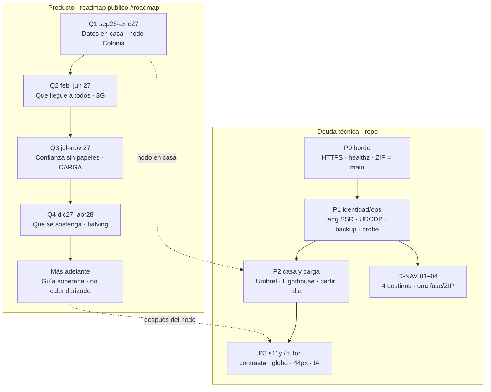

# Deuda técnica vigente — Bitácora.btc

**Fecha:** 13 de setiembre de 2026 · **Retomar el 16 set 2026**  
**Canónica:** `https://bitacorabtc.org` · VPS Njalla `45.158.116.49` (Caddy → Node :8080)  
**Repo:** `prezpablo/bitacora.btc` `main` · teselas Esri **en `.org`** (D-TILE-ZIP cerrado 13 set) · deploy = ZIP  
**Legal:** [`DEUDA-LEGAL.md`](DEUDA-LEGAL.md) · **Híbrido:** [`DEUDA-PLAN-HIBRIDO.md`](DEUDA-PLAN-HIBRIDO.md) · **Tests:** [`TEST-EXTERNO.md`](TEST-EXTERNO.md) · smoke [`SMOKE-DIARIO.md`](SMOKE-DIARIO.md) · cotejo informe [`INFORME-REFUTACION-2026-09-11.md`](INFORME-REFUTACION-2026-09-11.md)

## Acuerdo 11 set (tarde) — congelado

Caja gris recalibrada. **P0 de infra retirados. No reabrir.** Superficie oponible hoy: sitio + CSV + snapshots + `/healthz` + `/legal`. FLOSS oponible **solo** cuando el repo liste 200 anónimo.

**Seguimiento automático:** cola [`deuda-cola.json`](deuda-cola.json). `npm run deuda:status` · `npm run deuda:live`. **Calidad:** `npm run quality` (test + eslint dominio/aplicación + auth + deuda). `npm run quality:full` = tsc + eslint global (D-QA, aún DEGRADA). Cron VPS 08:22; Grok 08:10 -03.

| Retirado (no backlog P0) | Queda (severidad justa) |
|---|---|
| `/health` 404, CSV token como fuga, snapshot ausente, lang fijo sin `?lang=`, legal por API, serverFn CVE, www/SAN, Geo-IP, `/privacidad` 404, SSRF P0, Mercado = down, globo = no hay mapa, FormSubmit oculto, REST v1 ya | **D-FOSS** · **D-PIN** · **D-STATS** · **D-CTA** · **D-418** · **D-MKT** UX · globo-first · D-A11Y-24 · D-SITEMAP · PWA / LICENSE |

---

## Cola desde el 16 set — una fase por ZIP

No fusionar. Estilos: tokens actuales. No Mapbox GL, no API keys, no OSMF, no Carto.

| Orden | Id | Qué | Verificación | Cómo volver |
|---|---|---|---|---|
| **0** | **D-TILE-ZIP** | CSP Esri + OpenTopoMap, sin OSMF/Carto. | **Cerrado en `.org` 13 set.** `deuda:live` CERRADO. | N/A |
| **0b** | **D-FOSS** | GitHub: visibilidad **Public**. Clone anónimo 200. `LICENSE` MIT o AGPL. Link en `/legal` y 404. Hasta entonces no oponer «FOSS» a BTC Map. | `curl -sI https://github.com/prezpablo/bitacora.btc` → 200 | Settings → Change visibility |
| **1** | **D-PIN-01** | `moveend` **antes** de `setView`. Bbox inicial = `null` (no MVD). Query de comercios recién con bounds reales. | **Hecho en repo 13 set.** | Restaurar `west: -56.35` + query al montar |
| **1c** | **D-VIZ-01** | Velas = `.bit-stage` (misma caja que globo/mapa). Sacar `recharts` (no se usa; 2.x muerto). Canvas propio se queda. | **Este ZIP 13 set.** `price-chart` + fallbacks `bit-stage`; `package.json` sin recharts | 58dvh + volver a instalar recharts |
| **1d** | **D-VIZ-02** | ETF y calor de liquidación al **ancho real** (ResizeObserver / `viewBox` fluido). Patrón visx ParentSize, **sin** instalar visx. | **Este ZIP 13 set.** ETF no 720×220; calor no 920×400 `none` | SVG fijo |
| **1e** | **D-VIZ-03** | Táctil: 3 ticks Y/X, hit vela ≥ 24 px, EMA en menú no 4 chips. | Tras D-VIZ-02 | chips actuales |
| **2** | **D-PIN-02** | Supercluster **en el VPS** (`getMerchants(bbox, zoom)`). Índice en memoria desde catálogo SQLite. Nada de `LIMIT 800` sin orden. Leaflet solo pinta lo que vuelve (~50–200 clusters). Dependencia: `supercluster` MIT. | Zoom continente: clusters LATAM. Zoom 9+: pines sueltos. Catálogo 27 k no se recorta a los primeros 800 del JSON | Quitar paquete + devolver `catalogShopsInBox` LIMIT |
| **3** | **D-PIN-03** | Payload flaco tipo BTC Map v4: `id,lat,lon,icon` al cluster; ficha rica **al clic**. | Red tab: respuesta de comercios < ~50 KB gzip | Restaurar `MerchantPlace` completo en el GET |
| **4** | **D-STATS** | Totales del globo: **Latam** vs **BTC Map mundial**. Copy i18n 3 idiomas. No inflar “Mapa Latam” con 27 k globales. | Globo y FAQ muestran dos líneas | Revertir strings |
| **5** | **D-CTA** | Separar “Sumate” (cargar punto) de “Apoyá con sats” (QR). Header no pone donar al lado de alta. | Un CTA de mapa, donación en pie o `#aportes` | Restaurar QR compacto en header |
| **6** | **D-418** | Verificar React #418: `lang` SSR vs `localStorage` sin `?lang=`. Si el HTML es `es` y el cliente hidrata `en`, fijar idioma **antes** del render (URL gana). | Consola `.org` sin #418; `html lang` = copy | Solo si se reproduce |
| **7** | **D-TILE-03** | Teselas propias: OpenFreeMap / PMTiles. Sale Esri US. | CSP sin `arcgisonline` | Volver a D-TILE-01 |
| **8** | **P3 lote** | Skip 404 · sitemap `lastmod` (sigue 2026-09-07) · **D-A11Y-24** pie `#datos` < 24px · contraste `/labif` `.kicker` · globo/velas teclado · PWA fuera de `/__grok/` · `LICENSE` · `img-src` allowlist · banner compacto | Por ítem | Por ítem |

**Referentes públicos (13 set) — qué clonar, qué no**

| Deuda | Repo | Encaje | No |
|---|---|---|---|
| **D-PIN-02** | [mapbox/supercluster](https://github.com/mapbox/supercluster) MIT | Índice en el VPS: `getClusters([w,s,e,n], zoom)`. 27 k caben en RAM. | Leaflet.markercluster (minutos a 100 k) |
| **D-PIN-02** patrón HTTP | [rowanwins/supercluster-server](https://github.com/rowanwins/supercluster-server) MIT | Solo el patrón bbox+zoom. **No** otro proceso HTTP: va en `getMerchants`. | Redis / NetCluster (pines no se mueven) |
| **D-PIN-03** | [teambtcmap/btcmap.org#276](https://github.com/teambtcmap/btcmap.org/issues/276) | Dump `id,lat,lon,icon` ~200 KB gzip | Mandar ficha completa al cluster |
| **D-TILE-03** | [protomaps/PMTiles](https://github.com/protomaps/PMTiles) + [leafletRasterLayer](https://docs.protomaps.com/pmtiles/leaflet) | Un archivo en el VPS, Leaflet actual, sin MapLibre. Njalla no aguanta 300 GB. | [hyperknot/openfreemap](https://github.com/hyperknot/openfreemap) **self-host** (300 GB). SÍ vale su **instancia pública** (sin API key, sin cookies) como tesela remota |
| **D-FOSS** | [choosealicense.com](https://choosealicense.com/licenses/) | Tras Public: **AGPL-3.0** si el overlay debe seguir abierto al usarse en red (como BTC Map); MIT si se prioriza reuso. GitHub Settings → Add license. | LICENSE sin visibilidad Public |
| **D-PWA** | Manifest estático `/manifest.webmanifest` | TanStack Start pelea con [vite-plugin-pwa](https://github.com/vite-pwa/vite-plugin-pwa) ([discussion #4770](https://github.com/TanStack/router/discussions/4770)). Un JSON + iconos propios basta. | Service worker Workbox ahora |
| **D-A11Y-24** | Ya usamos [dequelabs/axe-core](https://github.com/dequelabs/axe-core) (`npm run test:a11y`) | Subir `min-h/min-w` del link `#datos` del pie a 24px. Contraste `.kicker` LABIF. | No subir umbral axe a 44px en la misma fase |
| **D-QA** | eslint 9 + tsc ya en `npm run quality` | `quality:full` cuando se limpien imports `.ts` de tests | knip, Sonar, Codecov |
| **D-VIZ-01/02** | [leeoniya/uPlot](https://github.com/leeoniya/uPlot) MIT · [airbnb/visx](https://github.com/airbnb/visx) `ParentSize` | Gesto y ancho. **No paquete** si el canvas propio ya pinta | [tradingview/lightweight-charts](https://github.com/tradingview/lightweight-charts) (atribución TV) · ECharts/Nivo/Recharts v3 (peso) · Highcharts |

**Prioridad D-VIZ (13 set):** P2 `01` hecho → P2 `02` **este ZIP** → P3 `03` siguiente (ticks, hit 24 px, EMA menú; blur SVG en coarse). **Siguiente fase: D-VIZ-03.** No Lightweight Charts.

OpenFreeMap público: mismo ethos que Njalla (sin registro, sin key). Self-host OFM **no entra** en esta VPS.

---

**Hallazgos 13 set (sonda, no P0 nuevo)**

- Live 20/20 · SEO 81/81 · guards 4/4 · teselas Esri en origen.
- `sitemap lastmod` 2026-09-07 (D-SITEMAP).
- axe: `a[href$="/#datos"]` target-size en `/` `/mapa` `/legal`; contraste `.kicker` en `/labif` (D-A11Y-24).
- Runner: Binance 451 — no reabrir como CAÍDA.
- Sandbox a veces pisa `scripts/grok-pwa-shared.mjs` (export `langFromSearch`); `git checkout HEAD --` ese archivo si `npm test` falla en grok-pwa. No es deuda de producto.

**Diagnóstico 11 set (por qué no se ven todos los comercios):**
1. `bbox` arranca en MVD (`spend-map.tsx` ~L161). `setView` dispara `moveend` **antes** del listener → el recorte nunca es el de la vista.
2. `catalogShopsInBox` `LIMIT 800` sin `ORDER BY`. Seed 27.403 locales; los primeros 800 del JSON no son LATAM (~365).
3. Zoom < 9 agrupa en “ciudades” (a propósito). Sin (1)+(2) el continente queda vacío.
4. Teselas Esri/Carto **no** cortan el catálogo.

---

## Informe caja gris 11 set — cotejo (no pentest)

Fuente: revisión de superficie pública 11 set 2026. **Caja gris ≠ fuente de verdad.** Varios P0 del informe ya están cerrados o son errores de observación. Refutación punto a punto: [`INFORME-REFUTACION-2026-09-11.md`](INFORME-REFUTACION-2026-09-11.md).

### El informe se equivoca (no abrir deuda)

| Dice el informe | En el producto |
|---|---|
| «El código no es público» | **Parcial.** Push con sesión ≠ clone anónimo (404). D-FOSS. |
| «Sin healthcheck `/health` 404» | Existe **`GET /healthz`** `{ok:true}`. Probed P0-13. |
| «CSV con tokens de carga» | Columna `token` vacía en público. CI: `stringifyMapCsvPublic` / `privacy-a11y-guards`. |
| «Sin snapshot BTC Map» | `public/data/btcmap-shops.json` (~27 k) + SQLite catálogo + TTL 6 h. El hueco es el **LIMIT 800**, no la ausencia de dump. |
| «FormSubmit es el único canal y el legal no avisa» | `/legal` declara FormSubmit→Gmail. Ops: SMTP propio (abierto, no P0 producto). |
| «Rutas `/aprender` `/comunidad` `/mercado`» | **No hacer.** D-NAV: anclas en un desk. Sitemap de rutas reales: `/` `/mapa` `/legal` `/labif`. |
| «Apagar el globo en P0» | Producto: globo = relato; 3G ya salta a Leaflet (`slowNet`). Usable = D-PIN, no matar el globo. |
| «API REST pública v1 ya» | Overlay propio = 2 filas. Publicar API vacía no suma. Tras D-PIN + overlay. Plan híbrido. |
| «Leaflet.markercluster» | Descartado a 27 k. Supercluster servidor = D-PIN-02. |
| «No hay `/healthz` ni CI de CSV» | Hay ambos. |

### El informe acierta y **ya estaba** en deuda

| Hallazgo | Deuda vigente |
|---|---|
| Teselas Esri vs OSM/OpenFreeMap | D-TILE-01 (Esri temporal) → D-TILE-03 |
| Mapa lento / pines incompletos | D-PIN-01…03 |
| Mercado “sin datos” | Runner D-BN / D-MP. Vision+OKX+last-known. No es CAÍDA. |
| Globo 1.9 MB / no teclado | P3 globo teclado; 3G off; D-TILE-02 precarga Leaflet |
| FormSubmit + Gmail | Ops SMTP no-US |
| CSP `unsafe-inline` / wasm | P2 CSP · plan híbrido |
| sitemap `lastmod` 07-set | P1 sitemap |
| Skip 404, 44px, contraste | P3 lote |
| LN / Lightning Address | Q4 + Ops LN inbound. QR on-chain+LN ya |
| Umbrel / nodo en casa | Q1 |
| i18n legal “traducción automática” | Legal ES/PT/EN está **escrito** en `legal-eu.ts`. No reabrir. |
| Geo-IP vs “GPS no IP” | L0.5: Geo-IP solo extras o botón. Cumplido en código. |
| `/privacidad` 404 | Anclas `/legal#privacidad`. Banner ya apunta ahí. |

### El informe acierta y **entra** a la cola (16 set+)

| Id | Hallazgo | Pri | Nota |
|---|---|---|---|
| **D-STATS** | Contadores globales bajo marca Latam | P2 | Dos líneas: Latam / BTC Map mundial |
| **D-CTA** | QR donar al lado de Sumate | P2 | Semántica distinta |
| **D-418** | React #418 hidratación | P1 | Verificar; candidato `lang` localStorage |
| **D-PWA** | Namespace `/__grok/` | P3 | Manifest propio. robots ya Disallow |
| **D-CSP-IMG** | `img-src https:` amplio | P2 | Allowlist self + btcmap + data/blob + teselas |
| **D-BANNER** | Banner storage cubre pie | P3 | Compactar tras la 1ª visita |
| **D-LIC** | Sin archivo LICENSE | **Va con D-FOSS** | Inútil si el repo sigue 404 |
| **D-MKT** | Widgets Mercado vacíos enseñan fragilidad | P2 | Ocultar fila si el proxy trae vacío; no apagar precio+fees |
| **D-LABIF** | `/labif` en sitemap | P3 | Editorial. No es CVE. Datado / noindex opcional |
| **D-DARK** | Sin modo oscuro | P3 | Bitcoiner lo espera. No bloquea mapa |
| **D-API** | GeoJSON/CSV público versionado | P2 **después** de D-PIN | No P0 |
| **D-FOSS** | Repo GitHub 404 anónimo | P1 ops | Settings → Public. No oponer FLOSS hasta 200 |
| **D-GLOBE** | Globo-first en desktop | P3 producto | 3G ya Leaflet. No apagar el globo |

### No adoptar (choca con decisiones ya cerradas)

- Mega-menú, rutas nuevas de destinos, snap-scroll.
- Wallet connect, KYC, Turnstile, Google Fonts, OSMF/Carto tiles, `npm audit fix` de js-yaml en el VPS.
- Polymarket/CLARITY: recorte **después** de D-PIN (ruido, no incidente).
- Trusted Types: P2 CSP híbrido, no 16 set.
- Publicar OpenAPI con 2 filas de overlay.

---

## Mapa vigente (11 set)

Bitácora.btc = mapa + desk Bitcoin Latam, educación y altas con prueba pública `CARGA`. Visitante sin cuenta. Stack: TanStack Start, Leaflet, SQLite, Caddy.

**En el `.org` (antes del ZIP `8502f33`):** barra 4 destinos + Sumate, i18n SSR, CSP sin Google Fonts, shops/comms 200. Teselas OSMF 403 si el operador no instaló el ZIP.

**En `main` (`8502f33`):** D-TILE-01/02 — Esri World Street + OpenTopoMap, preconnect, Leaflet en idle, eventos después del mapa. Carto y `tile.openstreetmap.org` fuera.

**No hay CAÍDA.** Runner ≠ origen: mempool/Binance mudos desde *su* IP no apagan el desk.

**Navegación:** D-NAV-01…05 **cerrados en `.org`**.



### Roadmap de producto

| Fase | Ventana | Qué | Estado 7 set |
|---|---|---|---|
| **Q1** | sep 2026 – ene 2027 | Nodo en Colonia. Si se apaga, el sitio sigue. Nadie entra de afuera. | **Abierto.** Umbrel/Tailscale no existen. Desk = APIs públicas. |
| **Q2** | feb – jun 2027 | Mapa usable en celular/3G. Si un feed cae, el resto sigue. | **Parcial.** Lazy + globo off en 3G en código. Lighthouse real en `.org` no medido. |
| **Q3** | jul – nov 2027 | Alta con prueba pública, no KYC. Señal en bitcoin opt-in. Sin custodia. | **Parcial.** CARGA + pines 7d + parches + tickets. BIP-322 abierto. |
| **Q4** | dic 2027 – abr 2028 | Aportes P2P. Fees/bloques del nodo propio cuando esté. Memoria, no producto. | **Abierto.** QR LN ya. Inbound LN y fees-del-nodo no. |
| **Tutor** | no calendarizado | Guía pedagógica BTC + Bitácora + Consciencia + LCM. Corpus en casa, no nube. | **Futuro.** Escrito en roadmap (`main`). Falta ZIP. Ver § Tutor. |

### Deuda técnica

| Pri | Ítem | Estado | Dónde |
|---|---|---|---|
| **P0** | ZIP VPS = `8502f33` teselas Esri | **Ops** | Cola 16 set paso 0. CSP debe traer arcgisonline |
| **P1** | **D-FOSS** repo público + LICENSE | **Abierto · ops GitHub** | Hoy 404 anónimo. LABIF ya decía privado |
| **P0** | HTTPS / healthz / first-party 200 | **Cerrado** | shops/comms 200 (11 set) |
| **P1** | `html lang` + title SSR | **Cerrado en `.org`** | `/?lang=pt` → `lang=pt` |
| **P1** | Copy SSR (H1 / legal / contacto) | **Cerrado en `.org`** | H1 pt Boas-vindas / en Welcome |
| **P1** | Head SEO por ruta (canonical, hreflang, JSON-LD, 404 noindex, H1 único) | **Cerrado en `.org`** | `npm run test:seo` |
| **P1** | sitemap `lastmod` | **Abierto** | Sigue 2026-09-07 |
| **P1** | URCDP | Presentada 2 set | Revisión, no código |
| **P1** | Backup SQLite semanal fuera del VPS | Operador | `scp` a disco local |
| **P1** | Probe live en el VPS | Hecho en repo | `probe-live.mjs` · cron 08:20 |
| **P1** | Lazy viewport + mercado al `#mercado` | **Cerrado** | `in-view` + `LazyMount` |
| **P2** | D-TILE teselas sin OSMF/Carto | **En `main` `8502f33`** | Falta confirmar ZIP en `.org` (paso 0) |
| **P2** | **D-PIN-01…03** Supercluster + bbox real + payload flaco | **Abierto · 16 set** | § Cola. No LIMIT 800 |
| **P2** | **D-STATS** Latam vs mundial en el globo | **Abierto · 16 set** | Informe 11 set §3.2 |
| **P2** | **D-CTA** Sumate ≠ donar | **Abierto · 16 set** | QR sale del header |
| **P1** | **D-418** hidratación lang | Verificar 16 set | Solo si consola `.org` muestra #418 |
| **P2** | **D-CSP-IMG** `img-src` allowlist | Abierto | Hoy `https:` |
| **P2** | **D-MKT** ocultar widgets Mercado vacíos | Abierto | No apagar precio+fees |
| **P3** | **D-PWA** `/__grok/` → manifest propio | Abierto | robots ya Disallow |
| **P3** | **D-LIC** archivo LICENSE | **Va con D-FOSS** | Inútil si el repo sigue 404 |
| **P3** | **D-BANNER** storage compacto | Abierto | Tras 1ª decisión |
| **P3** | **D-DARK** modo oscuro | Abierto | No bloquea |
| **P3** | **D-LABIF** sitemap editorial | Abierto | noindex opcional |
| **P2** | Teselas soberanas (no Esri US) | Abierto · después de D-PIN | D-TILE-03 OpenFreeMap / PMTiles |
| **P2** | Lighthouse mobile 3G/4G en `.org` | Abierto | Meta ≥ 80 4G / ≥ 50 3G |
| **P2** | Cluster pines · fuente 400 | **Supersede** | Lo cubre D-PIN-02. No Leaflet.markercluster |
| **P2** | Partir alta fuera de `spend-map` | Abierto | Clean Architecture |
| **P2** | PWA offline geo + catálogo | Abierto | No ahora |
| **P2** | Umbrel + worker (plan híbrido) | Abierto | Q1. No fingir el nodo |
| **P2** | CSP sin `unsafe-inline` · BFF | Abierto | Plan híbrido |
| **P2** | P2-18 Google Fonts | **Cerrado en `.org`** | `font-src 'self'` Ubuntu self-host |
| **P3** | Skip en 404 `AppNotFound` | Abierto | Producto 4/4; 404 sin `#contenido` |
| **P3** | Captcha no visual | **Cerrado en `.org`** | Audio + sr-only (`bb8eb06`) |
| **P3** | Skip + foco visible + banner `region` | **Cerrado en `.org`** | Incl. `/labif` |
| **P3** | Contraste / táctiles 24–44px | Parcial | `--color-short` y LABIF oscurecidos; 44px abierto |
| **P3** | Globo / velas por teclado · LRM fuera del bundle | Abierto | |
| **P3** | `js-yaml` high (npm audit) | Abierto | No parsea YAML de usuarios. No `npm audit fix` en VPS |
| **P3** | Tutor soberano (IA) | **No ahora** | § Tutor. No en el VPS del mapa |
| **D-NAV** | 4 destinos + D-NAV-05 | **Cerrado en `.org`** | Mapa · Aprender · Comunidad · Mercado |
| **Ops** | LN inbound · SMTP no-US · HSTS preload | Abierto | Operador |

### Alertas runner (no son CAÍDA)

| Código | Qué hacer |
|---|---|
| D-MP-FEE / TIP | mempool.space mudo *en el runner*. Fees: ninja + emzy + blockstream + last-known. Avisar solo si el **probe VPS** también vacío 2–3 días. |
| D-BN | Binance 451. Vision + OKX cubren. Nunca «mercado caído». |
| D-FS | formsubmit.co timeout *en el runner*. El contacto va por server-fn del VPS. No es CAÍDA. |
| D-OSM / Carto | Tesela 200 con marca («blocked» / «API KEY REQUIRED»). Leaflet no dispara `tileerror`. **No usar.** D-TILE = Esri. |
| P0-12 shops 404 | Falso positivo si el GET de 3 MB corta a 8 s. Origen 200. Timeout smoke ≥ 12 s. |
| P2-16 | `extensions.js` se omite en `bitacorabtc.org`. Preview Grok lo conserva. |

**No reabrir:** sslip.io como canónica. Nginx. CMP ads. Connect-wallet. Turnstile. First-party 404 del 30/08. OpenAI / Gemini / Groq / reCAPTCHA en el `.org`. Google Fonts remoto. Teselas OSMF o Carto sin clave. Rutas `/aprender`. Leaflet.markercluster. `/health` como P0 (`/healthz` existe). «FOSS oponible» mientras el repo sea 404 anónimo.

---

## Teselas · D-TILE (11 set)

OSMF y Carto devuelven PNG 200 con franja. El fallback a Esri **nunca** corría.

| Id | Qué | Estado |
|---|---|---|
| **D-TILE-01** | Primaria Esri World Street (sin API key). Reserva OpenTopoMap. CSP sin OSMF ni Carto. | **`main` `8502f33`.** Paso 0 = ZIP en VPS. |
| **D-TILE-02** | `preconnect` Esri + Leaflet en idle en el globo. Eventos después de `mapReady`. | **`main` `8502f33`.** |
| **D-TILE-03** | Teselas propias (OpenFreeMap / PMTiles en el VPS). | Abierto. **Después** de D-PIN. |

### D-PIN · pines (retomar 16 set)

Archivos: `src/components/map/spend-map.tsx` (bbox L161, `moveend` ~L596), `src/infrastructure/catalog.ts` (`LIMIT 800`), `src/infrastructure/btc-map.ts` (`fetchMerchants` slice 800), `src/lib/map-query.ts` (`useMapMerchants`), `src/domain/shop-cache.ts`.

Índice Supercluster: **servidor** (Node), no en el browser. `getMerchants` pasa a recibir `zoom`. Dominio no importa Leaflet.

No partir `spend-map.tsx` en la misma fase que D-PIN-02.

---

## Navegación · D-NAV (10 set) — una fase por ZIP

Pedido: barra de 10 anclas es un índice interno, no un menú de novato (unión + conocimiento). Referentes: bitcoin.org (5 destinos), BTC Map (Maps / Maintain), Meetup (CTA Join), GOV.UK (tareas).

**Regla:** se implementa **una** fila, se mira en preview, se acepta o se revierte **ese** ZIP. No fusionar fases. Estilos: mismos tokens (`primary` #9a5600, `font-display`, `shadow-border`, header sticky). No inventar mega-menú ni hamburguesa hasta D-NAV-04 si el wrap de 4 ítems no entra en 320px.

Objetivo de barra (es / en / pt):

| Destino | es | en | pt |
|---|---|---|---|
| 1 | Mapa | Map | Mapa |
| 2 | Comunidad | Community | Comunidade |
| 3 | Aprender | Learn | Aprender |
| 4 | Mercado | Market | Mercado |
| CTA | Sumate | Join | Junta-te |

Pie: Hacia dónde vamos / Where we're heading / Para onde vamos · Contacto · Privacidad. «Consciencia Bitcoin» queda como H1 de Aprender, no como ítem de barra.

| Id | Qué entra | Archivos | Cómo volver atrás | Verificación |
|---|---|---|---|---|
| **D-NAV-01** | Barra = 4 destinos. Roadmap, legal y contacto **salen** de `NAV` y se listan en el pie. i18n `navAprender` + recorte de `navComunidad`. Anclas `#conciencia` `#pulso` `#historia` `#red` `#roadmap` siguen en el HTML. IA en `domain/nav.ts`. | `domain/nav.ts`, `site-header.tsx`, `i18n.ts` | Revertir esos archivos + `domain/nav.test.ts`. | **Hecho en repo (10 set).** Preview: una fila, 4 palabras + pie. Aprender → `#conciencia`. |
| **D-NAV-02** | Hub **Aprender**: `#aprender` envuelve Consciencia + Historia + Pulso. Índice corto interno (qué es / historia / hoy). Barra apunta a `#aprender`. | `domain/nav.ts`, `desk.tsx`, `learn-index.tsx`, `i18n.ts` | Sacar el wrapper, devolver `hash` a `#conciencia`. | **Hecho en repo (10 set).** |
| **D-NAV-03** | **Red** se fusiona en **Mercado**. `#red` queda como ancla interna. | `domain/nav.ts`, `desk.tsx` | Restaurar `<section id="red">` suelta. | **Hecho en repo (10 set).** |
| **D-NAV-04** | CTA **Sumate** en el header (`requestJoinMap`). QR compacto a partir de `sm`. Sin hamburguesa: 4 destinos caben. | `application/join-map.ts`, `site-header.tsx`, `map-gate.tsx`, `spend-map.tsx` | Quitar el botón del header. | **Hecho en repo (10 set).** |
| **D-NAV-05** | Desk en 3 destinos + pie: Mapa+Aprender scrollean juntos; Comunidad y Mercado no se alcanzan con la rueda; roadmap fuera del medio. `SiteShell fill`. | `domain/nav.ts` (`sectorOf`), `desk.tsx`, `site-header.tsx` | Sacar `fill` y los wrappers `hidden`. | **Hecho en repo (10 set).** |

**Hecho (10 set, no es D-NAV):** dirección de comercio/comunidad **opcional**. El pin es el punto. `AddressSearch` sin `*`. `propose()` usa `drop.lat/lon`.

**No hacer en estas fases:** snap-scroll (ya revertido). Rutas nuevas `/aprender`. Cambiar CARGA. Traducir la marca Consciencia Bitcoin en el H1.

---

## Clean Architecture

| Capa | Qué | ¿Cumple? |
|---|---|---|
| `domain/` | CSV, guía, geo, legal, events, parches, fees, roadmap | **Sí** |
| `application/` | mercado, locate, applyListingPatch | **Sí** |
| `infrastructure/` | OSRM, BTC Map, SQLite, server-fns, vision/OKX | **Sí** |
| `components/` | UI | **Parcial** — `spend-map.tsx` sigue gordo |

No reescribir el mapa ahora. Partir el alta (P2) cuando no haya ZIP pendiente.

Regla de oro: el dominio no sabe de Leaflet ni de OSRM. La ruta y el GPS se piden **después** del clic (consentimiento).

**Partido:** `use-map-guide.ts`, `leaflet-fix.ts`, `domain/street-addr.ts`, `hydrateMapCsv`, `event-board`, `lib/in-view.ts`.

**Sigue gordo (no reescribir ahora):** `spend-map.tsx` (~1.3k), `extra-feeds.ts`, `btc-map.ts`, `i18n.ts`, LRM en `package.json` casi sin uso.

**Ops cerrado:** DNS SPF `-all` + DMARC `p=reject` + CAA. Pimienta IP en `/etc/bitacora.env`. QR on-chain + LN (BIP-322 pendiente).

---

## Tutor soberano (futuro, 7 set)

Pedido de estudio, **sin implementar**. Guía pedagógica de Bitcoin + Bitácora + Consciencia Bitcoin + LATAM Cripto Mom, en es/pt/en, anclada a soberanía, no custodia y «no confíes, verificá». Público en el roadmap (`domain/roadmap-web3.ts`, fase `tutor`).

**No es un chatbot de un tercero ni un modelo en el mismo VPS.** Njalla (1.5–9 GB) ya corre Caddy + Node + SQLite + mapa. Un 3B pide ~4 GB libres; un 7B, ~8–16 GB. En la misma máquina se pelea con el mapa.

| Pieza | Repo | Uso |
|---|---|---|
| Patrón (FTS + prompt, no clonar) | [CHATTY](https://github.com/arbadacarbaYK/CHATTY) | Node + SQLite FTS + Ollama 3B. Local, no público |
| Inferencia | [llama.cpp](https://github.com/ggml-org/llama.cpp) | Caja 2 (nodo en casa / Umbrel). API local |
| Pesos «Satoshi 7B» | [HF contrapliant](https://huggingface.co/contrapliant/Satoshi-7B) | **No de entrada.** Inglés, sesgo político, no pedagogía Latam |
| RAG apps (Open WebUI, AnythingLLM, PrivateGPT) | — | Pesados, otra UI, Docker. No pegan en Clean Architecture |
| ChatBTC, Groq, Gemini, Bitcoin-PAL | — | **Descartados.** Nube US/Google o repos muertos |

Orden cuando se retome (después del nodo en casa, Q1 del roadmap):

1. Corpus cerrado + FTS (whitepaper, `/conciencia`, `/legal`, LCM). Sin LLM. Cero alucinación.
2. Prompt + citas + i18n. Sin consejo financiero, sin llaves, sin altcoins.
3. Widget en el desk. Server-fn con rate limit y captcha. El modelo **no** vive en `/var/www/bitacora`.
4. Recién ahí llama.cpp ~3B en la máquina del nodo. Si esa caja se apaga, el `.org` sigue.

Fine-tune propio: no. Bitácora/Consciencia/LCM van en el corpus, no en los pesos. Agent con shell o wallet: no.

Legal: el diálogo es dato (URCDP). Tope, retención corta, mismo criterio que contacto.

---

## Tests

| Capa | Comando | Si falla |
|---|---|---|
| Dominio / guards | `npm run test:bitacora` | No mergear |
| Live `.org` | `npm run test:live` | Exit 1 = CAÍDA. `DEGRADA` = runner o SSR |
| SEO | `npm run test:seo` | Exit 1 = identidad rota |
| A11y axe | `npm run test:a11y` | Exit 1 = contrast/label/skip graves |
| Manual mapa/desk | [`TEST-EXTERNO.md`](TEST-EXTERNO.md) § D | Checklist humano |

### IntersectionObserver

```
desk (mapa + conciencia)
  └ LazyMount → roadmap, pines, eventos, feed, pulso, historia, velas, contacto
#mercado ref=useInView("280px") → wantLive (market, extras, tick, onchain, etf, pulse)
```

Latch al intersectar. Hash `#mercado|#red|#pulso|#datos` salta el gate.

Lighthouse: sin CI. 3G: globo off (`map-gate`), heatmap off, afiches lazy, mercado gated. Cierre: scores reales en DevTools sobre el `.org`.
