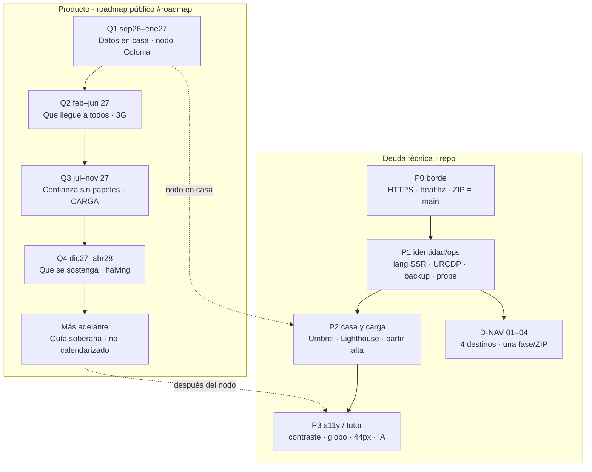

# Deuda técnica vigente — Bitácora.btc

**Fecha:** 13 de octubre de 2026  
**Canónica:** `https://bitacorabtc.org` · VPS Njalla `45.158.116.49` (Caddy → Node :8080)  
**Repo:** `prezpablo/bitacora.btc` `main`  
**Legal:** [`DEUDA-LEGAL.md`](DEUDA-LEGAL.md) · **Híbrido:** [`DEUDA-PLAN-HIBRIDO.md`](DEUDA-PLAN-HIBRIDO.md) · **Tests:** [`TEST-EXTERNO.md`](TEST-EXTERNO.md) · smoke corto [`SMOKE-DIARIO.md`](SMOKE-DIARIO.md) · largo [`TEST-COMPLETO.md`](TEST-COMPLETO.md) · **ZIP VPS:** [`COMANDOS-ZIP.md`](COMANDOS-ZIP.md)

## Acuerdo 11 set (tarde) — congelado

Caja gris recalibrada. **P0 de infra retirados. No reabrir.** Superficie oponible hoy: sitio + CSV + snapshots + `/healthz` + `/legal`. FLOSS oponible **solo** cuando el repo liste 200 anónimo.

**Seguimiento:** cola [`deuda-cola.json`](deuda-cola.json). `npm run deuda:status` · `npm run deuda:live`. **Calidad:** `npm run quality`. Cron VPS 08:22; Grok Automations = prompt corto de `SMOKE-DIARIO.md` (~2,9 k).

| Retirado (no backlog P0) | Queda abierto |
|---|---|
| `/health` 404, CSV token, snapshot ausente, lang fijo, legal API, serverFn CVE, www/SAN, Geo-IP, REST v1, Mercado=down, globo=no hay mapa, P0-09/P0-12 del probe viejo, L-BRACKET, L-CONTRA, L-ACK, L-N1, L-XFER, A-01, L-URCDP, L-PAIS, A-04 | **L-IP** (ZIP) · **A-07** · **D-FOSS** · **D-STATUE** |

---

## Checklist legal — 13 oct 22:22 -03, cotejo del .org

Informe «Datos personales y accesibilidad» (dos pasadas, 21:01 y 21:19). Esa pasada miró la versión 2.0. El sitio publicado ahora es **versión 2.4** (`/healthz` `{"ok":true}`, bundle `index-DthQSnb0.js`). Esto no es dictamen.

### Cumple (no reabrir)

| Id del informe | En el .org de esta pasada |
|---|---|
| D1 nombre y domicilio | «Pablo Daniel Perez Correa» y «Colonia del Sacramento, Colonia, Uruguay». Sin calle, sin cédula, sin RUT. |
| D5 casilla al publicar | El bundle trae «Acepto publicar estos datos» y «Acepto publicar esta experiencia». |
| Experiencias | Fila en la tabla y regla 10. Licencia CC BY 4.0. |
| N5 país de Njalla | Finlandia. |
| A1 pausa del pulso | «Pausar ciclo» en el bundle. `prefers-reduced-motion` lo frena. |
| `/COPYRIGHT` | Solo Consciencia Bitcoin by LATAM Cripto Mom. El nombre civil no está. `/LICENSE` sigue AGPL. |
| L-BRACKET, L-CONTRA | No hay corchetes ni Ley 17.250. «formulario de Contacto» nombra el relé, no la vía de derechos. |
| A10 «Bircoiner» | Marca pedida. No es errata. |

### No cumple — entra a la cola

| Orden | Id | Pri | Informe | Qué falta en el .org | Quién |
|---|---|---|---|---|---|
| 1 | **L-N1** | P0 | N1 | **En el .org** (22:41). Lista «Reciben lo que publicás o lo que nos escribís». | — |
| 2 | **L-XFER** | P0 | D4, N2 | **En el .org** (22:41). Casilla aparte que nombra FormSubmit. | — |
| 3 | **L-IP** | P1 | N3 viejo | **En GitHub `9bd3b6d`, no en el .org.** El renglón sigue sin la IP. | ZIP |
| 4 | **L-PAIS** | P0 | A-03 | **En GitHub, no en el .org.** Textos 2.7. OpenFreeMap: Hungría, con enlace a sus términos. El resto que no declara país lo dice. | ZIP |
| 5 | **L-URCDP** | P0 | A-02 | **En GitHub, no en el .org.** Textos 2.6: sin número, la URCDP no lo asignó. La fecha no se publica. | ZIP |
| 6 | **L-VALOR** | P2 | D7 | Los derechos no nombran impugnar valoraciones. El informe v2 no lo repite. Sigue. | Código |
| 7 | **L-TAKEDOWN** | P2 | A-08 r.12 | El plazo de denuncia queda en la regla 12, oculto hasta que Pablo dé el número. | Código |
| 8 | **L-PSAV** | P2 | T4 | Solo Ley 20.345. La 20.446 y la Circular BCU 2507 no se citan hasta leerlas. | Confirmar, después código |
| 9 | **L-MKT-COPY** | P2 | T5 | En vivo: «si BTC sube hasta ahí, barre shorts». Distinto de A-07. | Código |
| 10 | **L-LABIT** | P3 | A-27 | No etiquetar hasta un sí o un no. El v2 lo baja a P3. | Pablo |

Siguen sin duplicar: captcha de audio (L2.1, hecho), D-FOSS, D-STATUE, D-DEPS (Firebase = A-24).

**Siguiente fase de código, si se acepta:** **A-07**. La hora del mercado lleva zona. La serie modelo dice que no es cotización. No mezclar con D-STATUE.

### Informe v2 — 13 oct 22:23 -03

Lista de 32 pedidos de código (Parte A) y 9 de Pablo (Parte B). No es dictamen. Los corchetes no se inventan. La versión de los textos sigue **2.4** hasta que se publique un bloque.

#### Entra, en este orden

| Id | Pri | Qué se hace | No se hace |
|---|---|---|---|
| **A-01** | P0 | Hecho en el repo (textos 2.5). Sin domicilio de notificación, el aviso no dice que figura. Queda la ciudad. Falta el ZIP para el .org. | No se publica una calle. |
| **L-URCDP** (A-02) | P0 | Hecho en el repo (textos 2.6). Sin número, dice que la URCDP no lo asignó. La fecha no se publica. Bases: contacto y seguridad. Falta el ZIP. | No se imprime «en trámite» como número. No se agregan anuncios ni experiencias. |
| **L-PAIS** (A-03) | P0 | Hecho en el repo (textos 2.7). OpenFreeMap enlaza Hungría a sus términos. BTC Map, GeoJS, ipwho.is y Lingva dicen que el proveedor no informa el país. Falta el ZIP. | No se adivina el país ni la instancia de Lingva. |
| **A-04** | P0 | Hecho en el repo (textos 2.8). La cita es «Ley 18.331, art. 23, inciso 2º, literal A». Gmail sigue en 12 meses. Falta el ZIP. | No se inventan plazos de logs ni de FormSubmit. |
| **A-07** | P1 | La hora del mercado lleva zona. En serie modelo, la cifra dice que no es cotización. | Las fuentes del aviso son las que el desk ya usa. No se inventa una lista. |
| **A-08** | P1 | Reglas 1, 6, 10 y 11 a 14, en los tres idiomas. El plazo de disputas queda oculto y se muestra el de 5 días hábiles. | La frase de que la ficha derivada de OSM «sigue la ODbL» queda en `[verificar]` (B-06). No se pega hasta leerla. |
| **A-09** | P1 | Cada envío manda la versión del texto y el formulario. | La IP no se guarda en claro. El hash, si entra, ensancha la base de seguridad y va con B-01. No en el mismo corte que el texto. |
| **A-10** | P1 | Título «Textos legales» / «Textos legais» / «Legal». Historial de 2.0, 2.2 y 2.4. | La fecha de vigencia no se imprime mientras sea un corchete. |
| **A-11** | P1 | Sacar «Brechas en curso» y «Plan:» de la página. El plan pasa a `TODO-legal.md`. | No nombrar el resumen de precios hasta que exista A-23. |
| **A-13** | P1 | El aviso público de vulneración no dice «cuando corresponda». | El procedimiento de 24 h y 72 h ya se mira contra `docs/incidentes.md` (L-OPS). No se duplica el documento si ya está. |
| **A-14** | P2 | Cron: códigos CARGA y de experiencias a los 30 días; pines a los 7. | Gmail no se borra desde el VPS. Es un aviso a Pablo. El plazo de logs no se inventa. |
| **A-15** | P2 | Tabla de claves reales, dicho si son `localStorage` o `sessionStorage`. | `bitacora-hit*` se confirma antes. Si es una animación, no entra en la tabla. |
| **A-17** | P2 | Enlace `mailto:` junto al captcha, en los tres idiomas. | El audio del captcha ya está. Esto no lo saca. |
| **A-18** | P2 | La apertura queda en la ley uruguaya y remite al anexo. Anexo: Brasil y Argentina, con el texto del informe. | El informe pide el EEE y no trae el párrafo. No se redacta uno. |
| **A-21** | P2 | La primera vez, cada término de `/legal` se dice en castellano. | «allowlist» no es «lista de fundadores». Si se explica: lista de direcciones permitidas. LABIF no se define hasta saber el texto. |
| **A-22** | P2 | 24 px en idioma, rangos 1D/1S/1M/6M, mapa y captcha. | No se sube el umbral a 44 px en el mismo corte. |
| **A-23** | P2 | Lista de lugares visible. Resumen escrito del precio, con zona (A-07). | No se esconde el globo del teclado si la lista todavía no equivale. |
| **A-25** | P3 | Sacar `privacyArt13` si ninguna pantalla la usa. | No se borra una clave que el aviso todavía muestra. |
| **A-26** | P3 | Junto al QR: aporte voluntario, sin contraprestación, no se revierte, la cadena es pública, no hay custodia. | — |
| **A-29** | P3 | `role="alert"` y el error ligado al campo. | — |
| **A-31** | P3 | Si se nombra el art. 14 de la LGPD: niños menores de 12 años. | No se publica «niños y adolescentes» hasta verificar. El propio informe lo marca. |

**D-FOSS** absorbe A-05 y A-19: el pie y el hash del commit se muestran cuando la URL responda 200 sin login, o cuando haya un paquete de fuentes. Hoy el repo anónimo sigue en 404. No se dice que el JavaScript servido es el código fuente. Antes de publicar: que no viajen `.env`, token de FormSubmit ni claves.

**D-DEPS** absorbe A-24: sacar Firebase del bundle si no se usa. Si se llega a usar, se informa como tercero. No las dos cosas.

#### No entra

| Id | Por qué |
|---|---|
| **A-12** «Bircoiner» | Marca pedida. No es una errata. No se cambia a «bitcoiner». |
| **A-06** titular del copyright | Lo define Pablo (B-06). No se asume que es él. `/COPYRIGHT` sigue como está. |
| **A-16** sacar FormSubmit | Hasta un sí (B-08) no hay fase. |
| **A-20** voseo de todo el sitio | Pase de copy aparte. No se mezcla con un ZIP legal. |
| **A-28** `og:locale` | Ya está `es_UY`, `pt_BR` y `en_US`. |
| **A-30** fecha de autoevaluación | Después de A-11, A-22, A-23 y A-29. No antes. |
| **A-32** proxy de teselas e imágenes | Choca con el uso de esas teselas en esta VPS. Después de los países, no antes. |
| Parte B (B-01 a B-09) | Trámites de Pablo. No son commits. |

#### Pablo, no el repo

| Id | Pri | Qué tiene que pasar para que el código avance |
|---|---|---|
| B-01 | P0 | Qué bases cubre la solicitud. Recién ahí se cambia «contacto y seguridad». |
| B-02 | P0 | Domicilio de notificación, acordado con un abogado. No el particular. Ahí se llena A-01. |
| B-03 | P0 | Confirmar si la presentación fue el 2 de setiembre de 2026, y la fecha de inicio del sitio. |
| B-04 | P1 | Número de trámite, y después el de inscripción. |
| B-05 | P1 | Carpeta de encargados y los dos plazos (logs y FormSubmit). |
| B-06 | P1 | Titular del copyright y si la CC BY 4.0 convive con la ODbL. |
| B-07 | P2 | Avisar a la URCDP si cambia un proveedor. Revisión trimestral. |
| B-08 | P2 | Sí o no a FormSubmit, a LABITCONF, al plazo de reclamos y a las fuentes de precio que se pueden nombrar. |
| B-09 | P3 | Delegado de datos: hoy no aplica. Una vulneración sigue el procedimiento de 72 h. |

### Cola vigente — lo que quedó de antes

Sondeo de las 20:41 superado por el de las 22:22. Experiencias, la versión 2.4 y el nombre ya están en el `.org`.

**Siguiente de producto, después del corte legal:** **D-STATUE**. D-FOSS sigue siendo un clic en GitHub.

### Parámetros 12 oct (no implementar en el mismo ZIP)

**Editar un comercio (D-PATCH-ALL).** El alta ya pide pin, código `CARGA-XXXX` y un enlace público. La modificación usa esa misma puerta, no un login. Una ficha propia (`local:` o `c:`) y una ficha de BTC Map se editan con los mismos campos. El cambio de BTC Map se guarda en la base de Bitácora (`map.csv`), con el mismo id, y no se escribe en el origen. Mover el pin más de 80 m vuelve a exigir un alta. Sin KYC.

**Experiencias (D-EXPERIENCIA).** Chip dentro de Comunidad, al lado de anuncios y eventos. No es la quinta entrada de la barra. Misma prueba pública. Campos extra, todos visibles: qué es la actividad, ciudad, fecha o «recurrente», precio en sats o «a convenir», y el enlace de la prueba. Bitácora no cobra ni custodia. Hasta que haya fichas propias no entra al sitemap (igual que D-SEO-CITY).

**Estatuas (D-STATUE).** Capa propia, miniatura y ficha. Solo piezas con foto pública y lugar confirmado. Entran como primera tanda: Budapest (Graphisoft Park, 2021, la de bronce con cara espejada) y El Zonte (2025, serie de Valentina Picozzi). Nueva York (NYSE, diciembre 2025) se agrega si la foto y la dirección se confirman. Lugano no se pincha: el monumento fue retirado. Viena se anuncia el 14 oct 2026: no va al mapa hasta que esté inaugurada. No scrapear satoshistatues.com.

### Informe ATP 23 set — qué entra y qué no

Semilla útil: intención local + primer uso + confianza. **No** tráfico de precio. Lo que el sitio ya responde (qué es, qué no es exchange, cómo cargar, CARGA, Uruguay, sin custodia) **no se reabre**.

| Entra (cola 5–7) | Por qué no rompe lo hecho |
|---|---|
| **D-AEO-FAQ** | Misma FAQ y mismo `#faq-seo`. Cero rutas. Texto real (lector de pantalla y crawler). |
| **D-COPY-FED** | D-STATS ya separó Latam / mundo. Solo rotula que el número grande es BTC Map. |
| **D-EVT-HTML** | Reusa Luma/Meetup/Eventbrite. Tope 6 para no inflar el HTML ni el TTFB. |

**Congelado (no fase):** **D-SEO-CITY**. Páginas «comercios en Montevideo» solo con ≥ 3 pines **del overlay** en esa ciudad, mismas reglas de skip/H1/idioma, y sin volcar fichas federadas como dato nuevo. Hasta entonces no entran al sitemap (H1.4 del plan híbrido).

**No entra** (datos, accesibilidad o incompatibilidad):

- Landings por keyword, rutas nuevas (`/aprender`, `/ciudad`, `/vs`).
- Recomendar wallets (Phoenix, Muun, Blink) o explicar cómo pasar sats a pesos/reales.
- Guía de Binance Pay o de cobrar por exchange.
- Scraper nuevo de meetups. La agenda que ya hay alcanza.
- Tratar 27 k comercios como directorio propio. El LABIF manda: overlay chico sobre BTC Map.

---

## Cola histórica 16 set (referencia)

| Orden | Id | Estado 21 set |
|---|---|---|
| 0 D-TILE-ZIP | Cerrado `.org` 13 set | — |
| 0b D-FOSS | **Sigue abierto** | clone anónimo 404 |
| 1–2 D-PIN-01/02, D-VIZ-* | Cerrados | — |
| 3 D-PIN-03 | Código flaco en server-fn; **snapshot 2,9 MB sigue** | reabre como D-PIN-03+ |
| 4–8g D-STATS … D-GLOBE-KEYS | Cerrados en repo | falta ZIP héroe en `.org` |

**Referentes públicos (13 set) — qué clonar, qué no**

| Deuda | Repo | Encaje | No |
|---|---|---|---|
| **D-PIN-02** | [mapbox/supercluster](https://github.com/mapbox/supercluster) MIT | Índice en el VPS: `getClusters([w,s,e,n], zoom)`. 27 k caben en RAM. | Leaflet.markercluster (minutos a 100 k) |
| **D-PIN-02** patrón HTTP | [rowanwins/supercluster-server](https://github.com/rowanwins/supercluster-server) MIT | Solo el patrón bbox+zoom. **No** otro proceso HTTP: va en `getMerchants`. | Redis / NetCluster (pines no se mueven) |
| **D-PIN-03** | [teambtcmap/btcmap.org#276](https://github.com/teambtcmap/btcmap.org/issues/276) | Dump `id,lat,lon,icon` ~200 KB gzip | Mandar ficha completa al cluster |
| **D-TILE-03** | [protomaps/PMTiles](https://github.com/protomaps/PMTiles) + [leafletRasterLayer](https://docs.protomaps.com/pmtiles/leaflet) | Un archivo en el VPS, Leaflet actual, sin MapLibre. Njalla no aguanta 300 GB. | [hyperknot/openfreemap](https://github.com/hyperknot/openfreemap) **self-host** (300 GB). SÍ vale su **instancia pública** (sin API key, sin cookies) como tesela remota |
| **D-FOSS** | [choosealicense.com](https://choosealicense.com/licenses/) | Tras Public: **AGPL-3.0** si el overlay debe seguir abierto al usarse en red (como BTC Map); MIT si se prioriza reuso. GitHub Settings → Add license. | LICENSE sin visibilidad Public |
| **D-PWA** | Manifest estático `/manifest.webmanifest` | TanStack Start pelea con [vite-plugin-pwa](https://github.com/vite-pwa/vite-plugin-pwa) ([discussion #4770](https://github.com/TanStack/router/discussions/4770)). Un JSON + iconos propios basta. | Service worker Workbox ahora |
| **D-A11Y-24** | Ya usamos [dequelabs/axe-core](https://github.com/dequelabs/axe-core) (`npm run test:a11y`) | Subir `min-h/min-w` del link `#datos` del pie a 24px. Contraste `.kicker` LABIF. | No subir umbral axe a 44px en la misma fase |
| **D-QA** | eslint 9 + tsc ya en `npm run quality` | `quality:full` cuando se limpien imports `.ts` de tests | knip, Sonar, Codecov |
| **D-VIZ-01/02** | [leeoniya/uPlot](https://github.com/leeoniya/uPlot) MIT · [airbnb/visx](https://github.com/airbnb/visx) `ParentSize` | Gesto y ancho. **No paquete** si el canvas propio ya pinta | [tradingview/lightweight-charts](https://github.com/tradingview/lightweight-charts) (atribución TV) · ECharts/Nivo/Recharts v3 (peso) · Highcharts |

**Referentes 21 set — actualizaciones útiles (no fusionar)**

| Objetivo | Repo / release | Encaje en Bitácora | No |
|---|---|---|---|
| **Estabilidad pines D-PIN-03** | [mapbox/supercluster **v9.1.0**](https://github.com/mapbox/supercluster/releases/tag/v9.1.0) (3 set) | Ya estamos en `^9.1.0`. v9 recorta heap ~57% y `getTileRaw`. Servir cluster por bbox/zoom en vez del JSON 2,9 MB. | Leaflet.markercluster |
| **Catálogo flaco** | [teambtcmap/btcmap-api](https://github.com/teambtcmap/btcmap-api) v4 `places?fields=` · [btcmap.org#276](https://github.com/teambtcmap/btcmap.org/issues/276) | API actualizada 18 set. Un dump `id,lat,lon,icon` + ficha al clic. Encaja educación+unión de comercios. | REST v1 propio; Nostr-login (#903) |
| **Teselas soberanas** | [protomaps/PMTiles 3.8.1](https://pypi.org/project/pmtiles/) (16 set) + [go-pmtiles extract](https://github.com/protomaps/go-pmtiles) | Recorte Latam `maxzoom=12` en un archivo en el VPS. Leaflet raster **sin** MapLibre. Caddy ya sirve estáticos. | OFM self-host 300 GB; Protomaps API de pago |
| **Calles si OFM muda** | [hyperknot/openfreemap](https://github.com/hyperknot/openfreemap) instancia pública | Seguir `tiles.openfreemap.org/styles/liberty`. Sin key/cookies = ethos Njalla. | linux_host en este VPS |
| **Globo móvil** | [vasturiano/react-globe.gl](https://github.com/vasturiano/react-globe.gl) `pointsMerge` · [zakky8/web-optimization](https://github.com/zakky8/web-optimization) (may 2026) | `pointsMerge`, `antialias:false` en 3G, DPR ≤2, curvature más gruesa. three ya 0.185. | R3F/drei (otro runtime) |
| **Cumplimiento / supply chain** | CVE-2026-45321 TanStack May 2026 | Lockfile + `npm ci`. No bump `@tanstack/*` a ciegas. CSRF de Start ya cubre server-fn. | Firebase/better-auth en producto (scaffold; recortar = D-DEPS) |
| **FLOSS oponible** | [teambtcmap/btcmap.org](https://github.com/teambtcmap/btcmap.org) AGPL, commit 20 set | D-FOSS: repo Public + AGPL. Ellos listan 200 anónimo; nosotros aún no. | LICENSE sin visibilidad |
| **Velas educativas** | [leeoniya/uPlot 1.6.32](https://github.com/leeoniya/uPlot/releases) OHLC | Solo si el canvas propio se vuelve frágil. ~45 KB MIT. | TradingView / Recharts v3 |
| **PWA** | manifest estático | Sin cambio. vite-plugin-pwa sigue peleando con Start. | Workbox ahora |

Siguiente producto de código: **D-PIN-03+**. Ops: ZIP `bfdca8e` y D-FOSS.

OpenFreeMap público: mismo ethos que Njalla (sin registro, sin key). Self-host OFM **no entra** en esta VPS.

---

**Smoke 21 set (Grok diario) — cotejo**

Informe: DEGRADA SEO/mapa/feed · TTFB 0,37 s · feeds_ok 14/18 · skip 5/5 · h1 4/5 · barra/habitaciones SI · license/pwa SI. Addr MATCH. **Sin CAÍDA ni incidente.**

| Ítem | ¿Activo en origen? | Veredicto | Prioridad |
|---|---|---|---|
| **P0-09** sitemap sin `/labif` y `/LICENSE` | **A propósito.** Sitemap = `/` `/mapa` `/legal`. `/labif` meta `noindex,follow`. `/LICENSE` `X-Robots-Tag: noindex, follow`. | Falso positivo del protocolo viejo. **No** reponer loc. | **D-SMOKE-09 cerrado en repo** (`SMOKE-DIARIO.md` ~2,9 k). Pegar en Grok Automations. |
| **P0-12** shops.json+comms.json 404 | **No.** `/data/btcmap-shops.json` 200 (2,9 MB) · `/data/btcmap-comms.json` 200 · `pins.csv` 200. 404 solo alias cortos. | Falso positivo. Igual 14–18 set. | No abrir. No alias. |
| **D-BN+D-MP-*** 451/timeout | Este runner. **OKX 200.** Desk HTML pinta. VPS: Vision+OKX+ninja/emzy. | DEGRADA-feed del probe, no mercado caído. | No reabrir. |
| **h1 4/5** | **6/6 aquí:** `/` `/pt` `/en` `/mapa` `/legal` `/labif`. | Hueco del probe. | No abrir. |

**Prioridad real:** ninguna alerta del smoke entra a cola de producto. Ops: ZIP `bfdca8e` (`.org` sigue `4W2ZuAE3`). Código siguiente = D-PIN-03+. D-FOSS = GitHub Public.

---

**Smoke 18 set (Grok diario) — cotejo**

Informe: DEGRADA-low · TTFB 0,4 s · feeds_ok 12/16 · license/pwa SI · habitaciones N/D (sin clics). **Sin CAÍDA ni incidente.** `.org` ya tiene `7a5d4ec` (banner LABITCONF + flyers CDN).

| Ítem | ¿Activo en origen? | Veredicto | Deuda |
|---|---|---|---|
| **P0-12** shops/comms geojson | **No.** `/data/btcmap-shops.json` 200 (2,9 MB) · `/data/btcmap-comms.json` 200. 404 solo `/data/shops.json` y `/data/comms.json`. | Falso positivo. Igual 14–17 set. | No abrir. No alias. |
| **D-BN** 451 | Runner. **Vision 200 + OKX 200.** | DEGRADA-feed, no mercado caído. | No reabrir. |
| **D-MP-*** timeout | Este runner mudo a mempool.space. VPS: ninja+emzy+blockstream+last-known. | On-chain no verificable *aquí*. | Avisar solo si el VPS queda vacío 2–3 días. |
| **h1 4/5** | **5/5 aquí:** `/` `/pt` `/en` `/mapa` `/legal`. | Hueco del probe (ruta no parseada), no copy. | No abrir. |
| **habitaciones N/D** | Sin browser. Contrato 4 destinos SSR SI. | N/D, no falla. | — |

Ninguna alerta entra a cola.

---

**Smoke 17 set (Grok diario) — cotejo**

Informe: DEGRADA · barra 4 destinos + CTA Telegram · habitaciones SI · TTFB 0,39 s · feeds_ok 12/16 · license SI · pwa SI. **Sin CAÍDA ni incidente.**

| Ítem | ¿Activo en origen? | Veredicto | Deuda |
|---|---|---|---|
| **P0-12** shops/comms 404 | **No.** `/data/btcmap-shops.json` 200 (2,9 MB) · `/data/btcmap-comms.json` 200 · `pins.csv` 200. 404 **solo** `/data/shops.json` y `/data/comms.json` (alias que no existen). | Falso positivo. Igual que 14–15 set. | No abrir. No inventar alias. |
| **D-BN** 451 | Este runner 451. **Vision 200 + OKX 200.** Desk HTML pinta Mercado. | DEGRADA-feed del probe, no mercado caído. | No reabrir. |
| **D-MP-*** timeout | Este runner mudo a mempool.space y ninja (8 s). VPS: ninja+emzy+blockstream+last-known. | On-chain no verificable *aquí*. No CAÍDA. | Avisar solo si el VPS queda vacío 2–3 días. |

**Prioridad:** ninguna de estas alertas entra a cola. Siguiente producto = D-FOSS (ops GitHub) o ítems P3 abiertos (globo teclado / D-418). No fusionar.

---

**Smoke 15 set 06:14 -03 (Grok diario) — cotejo**

Informe: DEGRADA · barra 4 destinos · habitaciones SI · TTFB 0,65 s · feeds_ok 13/18. **Sin CAÍDA ni incidente.**

| Ítem | ¿Activo en origen? | Veredicto | Deuda |
|---|---|---|---|
| **P0-12** shops/comms locales 404 | **No.** `/data/btcmap-shops.json` 200 (2,9 MB) · `/data/btcmap-comms.json` 200 · `map.csv` 200. 404 solo `/data/shops.json` (alias que **no existe**). | Falso positivo. Mismo del 14 set. | No abrir. D-SMOKE-12 cerrado. |
| **D-BN** Binance 451 | Runner 451. **Vision 200 + OKX 200.** Desk pinta. | DEGRADA-feed del probe, no mercado caído. | No reabrir. |
| **D-MP-FEE / TIP / NINJA** timeout | Este runner también mudo a mempool.space/ninja. VPS: ninja+emzy+blockstream+last-known. | On-chain no verificable *aquí*. No CAÍDA. | Avisar solo si probe **VPS** vacío 2–3 días. |
| **P2-03b** `*.tile.opentopomap.org` «no listado» | **Está** en `connect-src` del origen (Caddy). `img-src` ya es `https:`. Capa activa = Esri, fallback OpenTopo (D-TILE-ZIP). | Allowlist del probe desactualizada (P2-03 del protocolo **sí** nombra OpenTopo). | No abrir hueco CSP. |
| Navegación / UX | skip 4/4 · h1 5/5 · barra_contrato SI · i18n_h1 SI · habitaciones SI | Encaja. | — |
| D-FOSS | GitHub 404 anónimo | Sigue. LICENSE con D-FOSS. | Cola, no P0. |

Ninguna de estas alertas cambia la cola: **no hay P0 de mapa ni de CSP.** Siguiente fase = **D-STATS** tras el ZIP pendiente.

---

**Smoke 14 set 10:55 -03 (Grok diario) — cotejo**

Informe: DEGRADA · P0 19/20 · i18n 7/7 · barra 4 destinos · habitaciones SI · TTFB 0,59 s · cert 77 d · `precio_ok SI`. **Sin CAÍDA ni incidente.**

| Ítem del smoke | Veredicto | Nota |
|---|---|---|
| **P0-12** `/data/shops.json` + `/data/comms.json` 404 | **Falso positivo.** Paths cortos. Canónico: `/data/btcmap-shops.json` 200 · `/data/btcmap-comms.json` 200. P0-12 del protocolo ya lo nombra así. | Plantilla del informe decía `shops.json`. Corregida. **No abrir hueco de mapa.** |
| **D-BN** 451 | Runner. Vision+OKX cubren. | No reabrir mercado caído. |
| **D-IPWHO** 429 | GeoJS 200. | Locate vivo. |
| **P2-03b** `*.tile.opentopomap.org` en CSP | **A propósito** (D-TILE reserva). | No es fuga. Allowlist del probe desactualizado. |
| P3 16/18 · UX 18/20 | Encajan D-SITEMAP (`lastmod` 07-set) y skip 404. | Ya en cola P3. |

`/healthz` GET `{ok:true}`. Overlay `map.csv` 2 filas / `pins.csv` 2. Coherente.

---

**Hallazgos 13 set noche (sonda `.org`)**

- HTML: `Aprender`, `chip-row`, `bit-stage`, `/?lang=pt` → `lang=pt` + Boas-vindas. `/healthz` `{ok:true}`.
- JS `routes-2yBNM1db.js`: `chip-row`, `inert`, `grid-cols-2`. `/data/btcmap-shops.json` Last-Modified 13 set 23:16 UTC.
- CSP: Esri + OpenTopo; sin OSMF, Carto, Google Fonts.
- `sitemap lastmod` **D-SITEMAP este ZIP** (stamp al build).
- GitHub `prezpablo/bitacora.btc` **404 anónimo** (D-FOSS).
- Runner Binance 451 — no reabrir como CAÍDA.
- Sandbox a veces pisa `scripts/grok-pwa-shared.mjs`; `git checkout HEAD --` si `npm test` falla. No es deuda de producto.

**Diagnóstico 11 set (por qué no se ven todos los comercios):**
1. `bbox` arranca en MVD (`spend-map.tsx` ~L161). `setView` dispara `moveend` **antes** del listener → el recorte nunca es el de la vista.
2. `catalogShopsInBox` `LIMIT 800` sin `ORDER BY`. Seed 27.403 locales; los primeros 800 del JSON no son LATAM (~365).
3. Zoom < 9 agrupa en “ciudades” (a propósito). Sin (1)+(2) el continente queda vacío.
4. Teselas Esri/Carto **no** cortan el catálogo.

---

## Informe caja gris 11 set — cotejo (no pentest)

Fuente: revisión de superficie pública 11 set 2026. **Caja gris ≠ fuente de verdad.** Varios P0 del informe ya están cerrados o son errores de observación. Refutación punto a punto: [`INFORME-REFUTACION-2026-09-11.md`](INFORME-REFUTACION-2026-09-11.md).

### El informe se equivoca (no abrir deuda)

| Dice el informe | En el producto |
|---|---|
| «El código no es público» | **Parcial.** Push con sesión ≠ clone anónimo (404). D-FOSS. |
| «Sin healthcheck `/health` 404» | Existe **`GET /healthz`** `{ok:true}`. Probed P0-13. |
| «CSV con tokens de carga» | Columna `token` vacía en público. CI: `stringifyMapCsvPublic` / `privacy-a11y-guards`. |
| «Sin snapshot BTC Map» | `public/data/btcmap-shops.json` (~27 k) + SQLite catálogo + TTL 6 h. El hueco es el **LIMIT 800**, no la ausencia de dump. |
| «FormSubmit es el único canal y el legal no avisa» | `/legal` declara FormSubmit→Gmail. Ops: SMTP propio (abierto, no P0 producto). |
| «Rutas `/aprender` `/comunidad` `/mercado`» | **No hacer.** D-NAV: anclas en un desk. Sitemap de rutas reales: `/` `/mapa` `/legal` `/labif`. |
| «Apagar el globo en P0» | Producto: globo = relato; 3G ya salta a Leaflet (`slowNet`). Usable = D-PIN, no matar el globo. |
| «API REST pública v1 ya» | Overlay propio = 2 filas. Publicar API vacía no suma. Tras D-PIN + overlay. Plan híbrido. |
| «Leaflet.markercluster» | Descartado a 27 k. Supercluster servidor = D-PIN-02. |
| «No hay `/healthz` ni CI de CSV» | Hay ambos. |

### El informe acierta y **ya estaba** en deuda

| Hallazgo | Deuda vigente |
|---|---|
| Teselas Esri vs OSM/OpenFreeMap | D-TILE-01 (Esri temporal) → D-TILE-03 |
| Mapa lento / pines incompletos | D-PIN-01…03 |
| Mercado “sin datos” | Runner D-BN / D-MP. Vision+OKX+last-known. No es CAÍDA. |
| Globo 1.9 MB / no teclado | P3 globo teclado; 3G off; D-TILE-02 precarga Leaflet |
| FormSubmit + Gmail | Ops SMTP no-US |
| CSP `unsafe-inline` / wasm | P2 CSP · plan híbrido |
| sitemap `lastmod` 07-set | P1 sitemap |
| Skip 404, 44px, contraste | P3 lote |
| LN / Lightning Address | Q4 + Ops LN inbound. QR on-chain+LN ya |
| Umbrel / nodo en casa | Q1 |
| i18n legal “traducción automática” | Legal ES/PT/EN está **escrito** en `legal-eu.ts`. No reabrir. |
| Geo-IP vs “GPS no IP” | L0.5: Geo-IP solo extras o botón. Cumplido en código. |
| `/privacidad` 404 | Anclas `/legal#privacidad`. Banner ya apunta ahí. |

### El informe acierta y **entra** a la cola (16 set+)

| Id | Hallazgo | Pri | Nota |
|---|---|---|---|
| **D-STATS** | Contadores globales bajo marca Latam | P2 | Dos líneas: Latam / BTC Map mundial |
| **D-CTA** | QR donar al lado de Sumate | P2 | Semántica distinta |
| **D-418** | React #418 hidratación | P1 | Verificar; candidato `lang` localStorage |
| **D-PWA** | Namespace `/__grok/` | P3 | Manifest propio. robots ya Disallow |
| **D-CSP-IMG** | `img-src https:` amplio | P2 | Allowlist self + btcmap + data/blob + teselas |
| **D-BANNER** | Banner storage cubre pie | P3 | Compactar tras la 1ª visita |
| **D-LIC** | Sin archivo LICENSE | **Va con D-FOSS** | Inútil si el repo sigue 404 |
| **D-MKT** | Widgets Mercado vacíos enseñan fragilidad | P2 | Ocultar fila si el proxy trae vacío; no apagar precio+fees |
| **D-LABIF** | `/labif` en sitemap | P3 | Editorial. No es CVE. Datado / noindex opcional |
| **D-DARK** | Sin modo oscuro | P3 | Bitcoiner lo espera. No bloquea mapa |
| **D-API** | GeoJSON/CSV público versionado | P2 **después** de D-PIN | No P0 |
| **D-FOSS** | Repo GitHub 404 anónimo | P1 ops | Settings → Public. No oponer FLOSS hasta 200 |
| **D-GLOBE** | Globo-first en desktop | P3 producto | 3G ya Leaflet. No apagar el globo |

### No adoptar (choca con decisiones ya cerradas)

- Mega-menú, rutas nuevas de destinos, snap-scroll.
- Wallet connect, KYC, Turnstile, Google Fonts, OSMF/Carto tiles, `npm audit fix` de js-yaml en el VPS.
- Polymarket/CLARITY: recorte **después** de D-PIN (ruido, no incidente).
- Trusted Types: P2 CSP híbrido, no 16 set.
- Publicar OpenAPI con 2 filas de overlay.

---

## Mapa vigente (11 set)

Bitácora.btc = mapa + desk Bitcoin Latam, educación y altas con prueba pública `CARGA`. Visitante sin cuenta. Stack: TanStack Start, Leaflet, SQLite, Caddy.

**En el `.org` (`4e9dd76`, 13 set noche):** barra 4 destinos + Sumate, i18n SSR, CSP Esri+OpenTopo sin Google Fonts, chip-row, globo/mapa bit-stage, eventos 2×6 móvil, `/healthz` ok. Teselas OSMF/Carto **fuera**.

**No hay CAÍDA.** Runner ≠ origen.

**Navegación:** D-NAV-01…05 **cerrados en `.org`**.



### Roadmap de producto

| Fase | Ventana | Qué | Estado 7 set |
|---|---|---|---|
| **Q1** | sep 2026 – ene 2027 | Nodo en Colonia. Si se apaga, el sitio sigue. Nadie entra de afuera. | **Abierto.** Umbrel/Tailscale no existen. Desk = APIs públicas. |
| **Q2** | feb – jun 2027 | Mapa usable en celular/3G. Si un feed cae, el resto sigue. | **Parcial.** Lazy + globo off en 3G en código. Lighthouse real en `.org` no medido. |
| **Q3** | jul – nov 2027 | Alta con prueba pública, no KYC. Señal en bitcoin opt-in. Sin custodia. | **Parcial.** CARGA + pines 7d + parches + tickets. BIP-322 abierto. |
| **Q4** | dic 2027 – abr 2028 | Aportes P2P. Fees/bloques del nodo propio cuando esté. Memoria, no producto. | **Abierto.** QR LN ya. Inbound LN y fees-del-nodo no. |
| **Tutor** | no calendarizado | Guía pedagógica BTC + Bitácora + Consciencia + LCM. Corpus en casa, no nube. | **Futuro.** Escrito en roadmap (`main`). Falta ZIP. Ver § Tutor. |

### Deuda técnica

| Pri | Ítem | Estado | Dónde |
|---|---|---|---|
| **P0** | ZIP VPS = `4e9dd76` (13 set noche) | **Cerrado en `.org`** | chip-row · inert · Esri CSP · healthz |
| **P1** | **D-FOSS** repo público + LICENSE | **Abierto · ops GitHub** | 404 anónimo 13 set noche |
| **P0** | HTTPS / healthz / first-party 200 | **Cerrado** | shops/comms 200 (11 set) |
| **P1** | `html lang` + title SSR | **Cerrado en `.org`** | `/?lang=pt` → `lang=pt` |
| **P1** | Copy SSR (H1 / legal / contacto) | **Cerrado en `.org`** | H1 pt Boas-vindas / en Welcome |
| **P1** | Head SEO por ruta (canonical, hreflang, JSON-LD, 404 noindex, H1 único) | **Cerrado en `.org`** | `npm run test:seo` |
| **P1** | sitemap `lastmod` | **Este ZIP** | Stamp al build, no 2026-09-07 |
| **P1** | URCDP | Presentada 2 set | Revisión, no código |
| **P1** | Backup SQLite semanal fuera del VPS | Operador | `scp` a disco local |
| **P1** | Probe live en el VPS | Hecho en repo | `probe-live.mjs` · cron 08:20 |
| **P1** | Lazy viewport + mercado al `#mercado` | **Cerrado** | `in-view` + `LazyMount` |
| **P2** | D-TILE teselas sin OSMF/Carto | **Cerrado en `.org`** | D-TILE-01/02 + ZIP. Siguiente soberana = D-TILE-03 |
| **P2** | **D-PIN-01** bbox real · **D-PIN-02** Supercluster | **Cerrado 13 set** | **Siguiente: D-PIN-03** payload flaco |
| **P2** | **D-PIN-03** `id,lat,lon,icon` al cluster | **Cerrado este ZIP** | Ficha rica `getMerchant` al clic |
| **P2** | **D-STATS** Latam vs mundial en el globo | **Abierto · 16 set** | Informe 11 set §3.2 |
| **P2** | **D-CTA** Sumate ≠ donar | **Abierto · 16 set** | QR sale del header |
| **P1** | **D-418** hidratación lang | Verificar 16 set | Solo si consola `.org` muestra #418 |
| **P2** | **D-CSP-IMG** `img-src` allowlist | Abierto | Hoy `https:` |
| **P2** | **D-MKT** ocultar widgets Mercado vacíos | Abierto | No apagar precio+fees |
| **P3** | **D-PWA** `/__grok/` → manifest propio | Abierto | robots ya Disallow |
| **P3** | **D-LIC** archivo LICENSE | **Va con D-FOSS** | Inútil si el repo sigue 404 |
| **P3** | **D-BANNER** storage compacto | **Cerrado este ZIP** | Compacto tras 1ª visita |
| **P3** | **D-DARK** modo oscuro | Abierto | No bloquea |
| **P3** | **D-LABIF** sitemap editorial | **Cerrado este ZIP** | `/labif` noindex |
| **P2** | Teselas soberanas (no Esri US) | Abierto · después de D-PIN | D-TILE-03 OpenFreeMap / PMTiles |
| **P2** | Lighthouse mobile 3G/4G en `.org` | Abierto | Meta ≥ 80 4G / ≥ 50 3G |
| **P2** | Cluster pines · fuente 400 | **Supersede** | Lo cubre D-PIN-02. No Leaflet.markercluster |
| **P2** | Partir alta fuera de `spend-map` | Abierto | Clean Architecture |
| **P2** | PWA offline geo + catálogo | Abierto | No ahora |
| **P2** | Umbrel + worker (plan híbrido) | Abierto | Q1. No fingir el nodo |
| **P2** | CSP sin `unsafe-inline` · BFF | Abierto | Plan híbrido |
| **P2** | P2-18 Google Fonts | **Cerrado en `.org`** | `font-src 'self'` Ubuntu self-host |
| **P3** | Skip en 404 `AppNotFound` | Abierto | Producto 4/4; 404 sin `#contenido` |
| **P3** | Captcha no visual | **Cerrado en `.org`** | Audio + sr-only (`bb8eb06`) |
| **P3** | Skip + foco visible + banner `region` | **Cerrado en `.org`** | Incl. `/labif` |
| **P3** | Contraste / táctiles 24–44px | Parcial | `--color-short` y LABIF oscurecidos; 44px abierto |
| **P3** | Globo / velas por teclado · LRM fuera del bundle | Abierto | |
| **P3** | `js-yaml` high (npm audit) | Abierto | No parsea YAML de usuarios. No `npm audit fix` en VPS |
| **P3** | Tutor soberano (IA) | **No ahora** | § Tutor. No en el VPS del mapa |
| **D-NAV** | 4 destinos + D-NAV-05 | **Cerrado en `.org`** | Mapa · Aprender · Comunidad · Mercado |
| **Ops** | LN inbound · SMTP no-US · HSTS preload | Abierto | Operador |

### Alertas runner (no son CAÍDA)

| Código | Qué hacer |
|---|---|
| D-MP-FEE / TIP | mempool.space mudo *en el runner*. Fees: ninja + emzy + blockstream + last-known. Avisar solo si el **probe VPS** también vacío 2–3 días. |
| D-BN | Binance 451. Vision + OKX cubren. Nunca «mercado caído». |
| D-FS | formsubmit.co timeout *en el runner*. El contacto va por server-fn del VPS. No es CAÍDA. |
| D-OSM / Carto | Tesela 200 con marca («blocked» / «API KEY REQUIRED»). Leaflet no dispara `tileerror`. **No usar.** D-TILE = Esri. |
| P0-12 shops 404 | **14 set:** el runner pidió `/data/shops.json`. Canónico es `/data/btcmap-shops.json` (200, 2,9 MB). 404 del alias **no** es hueco de mapa. Timeout 3 MB ≥ 12 s sigue valiendo. |
| P2-16 | `extensions.js` se omite en `bitacorabtc.org`. Preview Grok lo conserva. |

**No reabrir:** sslip.io como canónica. Nginx. CMP ads. Connect-wallet. Turnstile. First-party 404 del 30/08. OpenAI / Gemini / Groq / reCAPTCHA en el `.org`. Google Fonts remoto. Teselas OSMF o Carto sin clave. Rutas `/aprender`. Leaflet.markercluster. `/health` como P0 (`/healthz` existe). «FOSS oponible» mientras el repo sea 404 anónimo.

---

## Teselas · D-TILE (11 set)

OSMF y Carto devuelven PNG 200 con franja. El fallback a Esri **nunca** corría.

| Id | Qué | Estado |
|---|---|---|
| **D-TILE-01** | Primaria Esri World Street (sin API key). Reserva OpenTopoMap. CSP sin OSMF ni Carto. | **Cerrado en `.org` 13 set.** |
| **D-TILE-02** | `preconnect` Esri + Leaflet en idle en el globo. Eventos después de `mapReady`. | **Cerrado en `.org` 13 set.** |
| **D-TILE-03** | Teselas propias (OpenFreeMap / PMTiles en el VPS). | Abierto. **Después** de D-PIN. |

### D-PIN · pines

| Id | Estado |
|---|---|
| **D-PIN-01** bbox `moveend` antes de `setView` | **Cerrado** |
| **D-PIN-02** Supercluster VPS, sin LIMIT 800 | **Cerrado** (`shop-cluster.ts`) |
| **D-PIN-03** payload flaco al cluster; ficha al clic | **Cerrado este ZIP** |

No partir `spend-map.tsx` en la misma fase que D-PIN-03. Dominio no importa Leaflet.

---

## Navegación · D-NAV (10 set) — una fase por ZIP

Pedido: barra de 10 anclas es un índice interno, no un menú de novato (unión + conocimiento). Referentes: bitcoin.org (5 destinos), BTC Map (Maps / Maintain), Meetup (CTA Join), GOV.UK (tareas).

**Regla:** se implementa **una** fila, se mira en preview, se acepta o se revierte **ese** ZIP. No fusionar fases. Estilos: mismos tokens (`primary` #9a5600, `font-display`, `shadow-border`, header sticky). No inventar mega-menú ni hamburguesa hasta D-NAV-04 si el wrap de 4 ítems no entra en 320px.

Objetivo de barra (es / en / pt):

| Destino | es | en | pt |
|---|---|---|---|
| 1 | Mapa | Map | Mapa |
| 2 | Comunidad | Community | Comunidade |
| 3 | Aprender | Learn | Aprender |
| 4 | Mercado | Market | Mercado |
| CTA | Sumate | Join | Junta-te |

Pie: Hacia dónde vamos / Where we're heading / Para onde vamos · Contacto · Privacidad. «Consciencia Bitcoin» queda como H1 de Aprender, no como ítem de barra.

| Id | Qué entra | Archivos | Cómo volver atrás | Verificación |
|---|---|---|---|---|
| **D-NAV-01** | Barra = 4 destinos. Roadmap, legal y contacto **salen** de `NAV` y se listan en el pie. i18n `navAprender` + recorte de `navComunidad`. Anclas `#conciencia` `#pulso` `#historia` `#red` `#roadmap` siguen en el HTML. IA en `domain/nav.ts`. | `domain/nav.ts`, `site-header.tsx`, `i18n.ts` | Revertir esos archivos + `domain/nav.test.ts`. | **Hecho en repo (10 set).** Preview: una fila, 4 palabras + pie. Aprender → `#conciencia`. |
| **D-NAV-02** | Hub **Aprender**: `#aprender` envuelve Consciencia + Historia + Pulso. Índice corto interno (qué es / historia / hoy). Barra apunta a `#aprender`. | `domain/nav.ts`, `desk.tsx`, `learn-index.tsx`, `i18n.ts` | Sacar el wrapper, devolver `hash` a `#conciencia`. | **Hecho en repo (10 set).** |
| **D-NAV-03** | **Red** se fusiona en **Mercado**. `#red` queda como ancla interna. | `domain/nav.ts`, `desk.tsx` | Restaurar `<section id="red">` suelta. | **Hecho en repo (10 set).** |
| **D-NAV-04** | CTA **Sumate** en el header (`requestJoinMap`). QR compacto a partir de `sm`. Sin hamburguesa: 4 destinos caben. | `application/join-map.ts`, `site-header.tsx`, `map-gate.tsx`, `spend-map.tsx` | Quitar el botón del header. | **Hecho en repo (10 set).** |
| **D-NAV-05** | Desk en 3 destinos + pie: Mapa+Aprender scrollean juntos; Comunidad y Mercado no se alcanzan con la rueda; roadmap fuera del medio. `SiteShell fill`. | `domain/nav.ts` (`sectorOf`), `desk.tsx`, `site-header.tsx` | Sacar `fill` y los wrappers `hidden`. | **Hecho en repo (10 set).** |

**Hecho (10 set, no es D-NAV):** dirección de comercio/comunidad **opcional**. El pin es el punto. `AddressSearch` sin `*`. `propose()` usa `drop.lat/lon`.

**No hacer en estas fases:** snap-scroll (ya revertido). Rutas nuevas `/aprender`. Cambiar CARGA. Traducir la marca Consciencia Bitcoin en el H1.

---

## Clean Architecture

| Capa | Qué | ¿Cumple? |
|---|---|---|
| `domain/` | CSV, guía, geo, legal, events, parches, fees, roadmap | **Sí** |
| `application/` | mercado, locate, applyListingPatch | **Sí** |
| `infrastructure/` | OSRM, BTC Map, SQLite, server-fns, vision/OKX | **Sí** |
| `components/` | UI | **Parcial** — `spend-map.tsx` sigue gordo |

No reescribir el mapa ahora. Partir el alta (P2) cuando no haya ZIP pendiente.

Regla de oro: el dominio no sabe de Leaflet ni de OSRM. La ruta y el GPS se piden **después** del clic (consentimiento).

**Partido:** `use-map-guide.ts`, `leaflet-fix.ts`, `domain/street-addr.ts`, `hydrateMapCsv`, `event-board`, `lib/in-view.ts`.

**Sigue gordo (no reescribir ahora):** `spend-map.tsx` (~1.3k), `extra-feeds.ts`, `btc-map.ts`, `i18n.ts`, LRM en `package.json` casi sin uso.

**Ops cerrado:** DNS SPF `-all` + DMARC `p=reject` + CAA. Pimienta IP en `/etc/bitacora.env`. QR on-chain + LN (BIP-322 pendiente).

---

## Tutor soberano (futuro, 7 set)

Pedido de estudio, **sin implementar**. Guía pedagógica de Bitcoin + Bitácora + Consciencia Bitcoin + LATAM Cripto Mom, en es/pt/en, anclada a soberanía, no custodia y «no confíes, verificá». Público en el roadmap (`domain/roadmap-web3.ts`, fase `tutor`).

**No es un chatbot de un tercero ni un modelo en el mismo VPS.** Njalla (1.5–9 GB) ya corre Caddy + Node + SQLite + mapa. Un 3B pide ~4 GB libres; un 7B, ~8–16 GB. En la misma máquina se pelea con el mapa.

| Pieza | Repo | Uso |
|---|---|---|
| Patrón (FTS + prompt, no clonar) | [CHATTY](https://github.com/arbadacarbaYK/CHATTY) | Node + SQLite FTS + Ollama 3B. Local, no público |
| Inferencia | [llama.cpp](https://github.com/ggml-org/llama.cpp) | Caja 2 (nodo en casa / Umbrel). API local |
| Pesos «Satoshi 7B» | [HF contrapliant](https://huggingface.co/contrapliant/Satoshi-7B) | **No de entrada.** Inglés, sesgo político, no pedagogía Latam |
| RAG apps (Open WebUI, AnythingLLM, PrivateGPT) | — | Pesados, otra UI, Docker. No pegan en Clean Architecture |
| ChatBTC, Groq, Gemini, Bitcoin-PAL | — | **Descartados.** Nube US/Google o repos muertos |

Orden cuando se retome (después del nodo en casa, Q1 del roadmap):

1. Corpus cerrado + FTS (whitepaper, `/conciencia`, `/legal`, LCM). Sin LLM. Cero alucinación.
2. Prompt + citas + i18n. Sin consejo financiero, sin llaves, sin altcoins.
3. Widget en el desk. Server-fn con rate limit y captcha. El modelo **no** vive en `/var/www/bitacora`.
4. Recién ahí llama.cpp ~3B en la máquina del nodo. Si esa caja se apaga, el `.org` sigue.

Fine-tune propio: no. Bitácora/Consciencia/LCM van en el corpus, no en los pesos. Agent con shell o wallet: no.

Legal: el diálogo es dato (URCDP). Tope, retención corta, mismo criterio que contacto.

---

## Tests

| Capa | Comando | Si falla |
|---|---|---|
| Dominio / guards | `npm run test:bitacora` | No mergear |
| Live `.org` | `npm run test:live` | Exit 1 = CAÍDA. `DEGRADA` = runner o SSR |
| SEO | `npm run test:seo` | Exit 1 = identidad rota |
| A11y axe | `npm run test:a11y` | Exit 1 = contrast/label/skip graves |
| Manual mapa/desk | [`TEST-EXTERNO.md`](TEST-EXTERNO.md) § D | Checklist humano |

### IntersectionObserver

```
desk (mapa + conciencia)
  └ LazyMount → roadmap, pines, eventos, feed, pulso, historia, velas, contacto
#mercado ref=useInView("280px") → wantLive (market, extras, tick, onchain, etf, pulse)
```

Latch al intersectar. Hash `#mercado|#red|#pulso|#datos` salta el gate.

Lighthouse: sin CI. 3G: globo off (`map-gate`), heatmap off, afiches lazy, mercado gated. Cierre: scores reales en DevTools sobre el `.org`.
