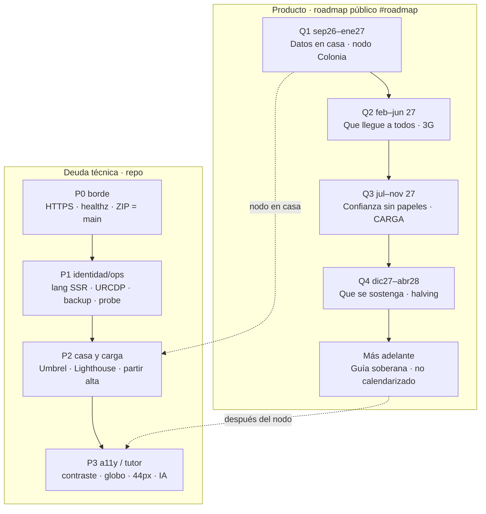

# Deuda técnica vigente — Bitácora.btc

**Fecha:** 7 de setiembre de 2026  
**Canónica:** `https://bitacorabtc.org` · VPS Njalla `45.158.116.49` (Caddy → Node :8080)  
**Repo:** `prezpablo/bitacora.btc` `main` (`7d4cc30`) · deploy = ZIP (el VPS no tiene `.git`)  
**Legal:** [`DEUDA-LEGAL.md`](DEUDA-LEGAL.md) · **Híbrido:** [`DEUDA-PLAN-HIBRIDO.md`](DEUDA-PLAN-HIBRIDO.md) · **Tests externos:** [`TEST-EXTERNO.md`](TEST-EXTERNO.md)

## Mapa vigente (7 set)

Bitácora.btc = mapa + desk Bitcoin Latam, educación y altas con prueba pública `CARGA`. Visitante sin cuenta. Stack: TanStack Start, Leaflet, SQLite, Caddy.

**En el `.org` hoy:** `lang` por `?lang=`, H1 único por ruta, skip en `/` `/mapa` `/legal` `/labif`, captcha con audio + sr-only, 404 noindex, probe SEO.

**En `main` y no en el `.org`:** fase pública «Guía soberana» (`7d4cc30`). El probe axe (`npm run test:a11y`) es de repo, no de sitio.

**No hay CAÍDA.** Runner ≠ origen: mempool/Binance mudos desde *su* IP no apagan el desk.



### Roadmap de producto

| Fase | Ventana | Qué | Estado 7 set |
|---|---|---|---|
| **Q1** | sep 2026 – ene 2027 | Nodo en Colonia. Si se apaga, el sitio sigue. Nadie entra de afuera. | **Abierto.** Umbrel/Tailscale no existen. Desk = APIs públicas. |
| **Q2** | feb – jun 2027 | Mapa usable en celular/3G. Si un feed cae, el resto sigue. | **Parcial.** Lazy + globo off en 3G en código. Lighthouse real en `.org` no medido. |
| **Q3** | jul – nov 2027 | Alta con prueba pública, no KYC. Señal en bitcoin opt-in. Sin custodia. | **Parcial.** CARGA + pines 7d + parches + tickets. BIP-322 abierto. |
| **Q4** | dic 2027 – abr 2028 | Aportes P2P. Fees/bloques del nodo propio cuando esté. Memoria, no producto. | **Abierto.** QR LN ya. Inbound LN y fees-del-nodo no. |
| **Tutor** | no calendarizado | Guía pedagógica BTC + Bitácora + Consciencia + LCM. Corpus en casa, no nube. | **Futuro.** Escrito en roadmap (`main`). Falta ZIP. Ver § Tutor. |

### Deuda técnica

| Pri | Ítem | Estado | Dónde |
|---|---|---|---|
| **P0** | ZIP VPS = `main` | **Abierto cada release** | Guía soberana aún no está en `.org` |
| **P0** | HTTPS / healthz / first-party 200 | **Cerrado** | 30/08 404 cerrado |
| **P1** | `html lang` + title SSR | **Cerrado en `.org`** | `/?lang=pt` → `lang=pt` |
| **P1** | Copy SSR (H1 / legal / contacto) | **Hecho en repo** · falta ZIP | Primer byte aún en es en `.org` |
| **P1** | Head SEO por ruta (canonical, hreflang, JSON-LD, 404 noindex, H1 único) | **Cerrado en `.org`** | `npm run test:seo` |
| **P1** | URCDP | Presentada 2 set | Revisión, no código |
| **P1** | Backup SQLite semanal fuera del VPS | Operador | `scp` a disco local |
| **P1** | Probe live en el VPS | Hecho en repo | `probe-live.mjs` · cron 08:20 |
| **P1** | Lazy viewport + mercado al `#mercado` | **Cerrado** | `in-view` + `LazyMount` |
| **P2** | Lighthouse mobile 3G/4G en `.org` | Abierto | Meta ≥ 80 4G / ≥ 50 3G |
| **P2** | Tiles 1× en 3G · cluster pines · fuente 400 | Abierto | UX, no bloquea |
| **P2** | Partir alta fuera de `spend-map` | Abierto | Clean Architecture |
| **P2** | PWA offline geo + catálogo | Abierto | No ahora |
| **P2** | Umbrel + worker (plan híbrido) | Abierto | Q1. No fingir el nodo |
| **P2** | CSP sin `unsafe-inline` · BFF | Abierto | Plan híbrido |
| **P3** | Captcha no visual | **Cerrado en `.org`** | Audio + sr-only (`bb8eb06`) |
| **P3** | Skip + foco visible + banner `region` | **Cerrado en `.org`** | Incl. `/labif` |
| **P3** | Contraste `.text-short` y naranja LABIF · links subrayados en párrafo | **Abierto** | axe 7 set: 1.4.3 y 1.4.1 |
| **P3** | Globo / velas por teclado · táctiles 44px · LRM fuera del bundle | Abierto | |
| **P3** | Tutor soberano (IA) | **No ahora** | § Tutor. No en el VPS del mapa |
| **Ops** | LN inbound · SMTP no-US · HSTS preload | Abierto | Operador |

### Alertas runner (no son CAÍDA)

| Código | Qué hacer |
|---|---|
| D-MP-FEE / TIP | mempool.space mudo *en el runner*. Fees: ninja + emzy + blockstream + last-known. Avisar solo si el **probe VPS** también vacío 2–3 días. |
| D-BN | Binance 451. Vision + OKX cubren. Nunca «mercado caído». |
| D-FS | formsubmit.co timeout *en el runner*. El contacto va por server-fn del VPS. No es CAÍDA. |
| P1-03 copy SSR | `lang`+title sí (inyector). Cuerpo del home en el primer byte: arreglo en repo (`retainLangSearch` + loader `getRequest`). Falta ZIP. |
| P2-16 | `extensions.js` se omite en `bitacorabtc.org`. Preview Grok lo conserva. |

**No reabrir:** sslip.io como canónica. Nginx. CMP ads. Connect-wallet. Turnstile. First-party 404 del 30/08. OpenAI / Gemini / Groq / reCAPTCHA en el `.org`.

---

## Clean Architecture

| Capa | Qué | ¿Cumple? |
|---|---|---|
| `domain/` | CSV, guía, geo, legal, events, parches, fees, roadmap | **Sí** |
| `application/` | mercado, locate, applyListingPatch | **Sí** |
| `infrastructure/` | OSRM, BTC Map, SQLite, server-fns, vision/OKX | **Sí** |
| `components/` | UI | **Parcial** — `spend-map.tsx` sigue gordo |

No reescribir el mapa ahora. Partir el alta (P2) cuando no haya ZIP pendiente.

Regla de oro: el dominio no sabe de Leaflet ni de OSRM. La ruta y el GPS se piden **después** del clic (consentimiento).

**Partido:** `use-map-guide.ts`, `leaflet-fix.ts`, `domain/street-addr.ts`, `hydrateMapCsv`, `event-board`, `lib/in-view.ts`.

**Sigue gordo (no reescribir ahora):** `spend-map.tsx` (~1.3k), `extra-feeds.ts`, `btc-map.ts`, `i18n.ts`, LRM en `package.json` casi sin uso.

**Ops cerrado:** DNS SPF `-all` + DMARC `p=reject` + CAA. Pimienta IP en `/etc/bitacora.env`. QR on-chain + LN (BIP-322 pendiente).

---

## Tutor soberano (futuro, 7 set)

Pedido de estudio, **sin implementar**. Guía pedagógica de Bitcoin + Bitácora + Consciencia Bitcoin + LATAM Cripto Mom, en es/pt/en, anclada a soberanía, no custodia y «no confíes, verificá». Público en el roadmap (`domain/roadmap-web3.ts`, fase `tutor`).

**No es un chatbot de un tercero ni un modelo en el mismo VPS.** Njalla (1.5–9 GB) ya corre Caddy + Node + SQLite + mapa. Un 3B pide ~4 GB libres; un 7B, ~8–16 GB. En la misma máquina se pelea con el mapa.

| Pieza | Repo | Uso |
|---|---|---|
| Patrón (FTS + prompt, no clonar) | [CHATTY](https://github.com/arbadacarbaYK/CHATTY) | Node + SQLite FTS + Ollama 3B. Local, no público |
| Inferencia | [llama.cpp](https://github.com/ggml-org/llama.cpp) | Caja 2 (nodo en casa / Umbrel). API local |
| Pesos «Satoshi 7B» | [HF contrapliant](https://huggingface.co/contrapliant/Satoshi-7B) | **No de entrada.** Inglés, sesgo político, no pedagogía Latam |
| RAG apps (Open WebUI, AnythingLLM, PrivateGPT) | — | Pesados, otra UI, Docker. No pegan en Clean Architecture |
| ChatBTC, Groq, Gemini, Bitcoin-PAL | — | **Descartados.** Nube US/Google o repos muertos |

Orden cuando se retome (después del nodo en casa, Q1 del roadmap):

1. Corpus cerrado + FTS (whitepaper, `/conciencia`, `/legal`, LCM). Sin LLM. Cero alucinación.
2. Prompt + citas + i18n. Sin consejo financiero, sin llaves, sin altcoins.
3. Widget en el desk. Server-fn con rate limit y captcha. El modelo **no** vive en `/var/www/bitacora`.
4. Recién ahí llama.cpp ~3B en la máquina del nodo. Si esa caja se apaga, el `.org` sigue.

Fine-tune propio: no. Bitácora/Consciencia/LCM van en el corpus, no en los pesos. Agent con shell o wallet: no.

Legal: el diálogo es dato (URCDP). Tope, retención corta, mismo criterio que contacto.

---

## Tests

| Capa | Comando | Si falla |
|---|---|---|
| Dominio / guards | `npm run test:bitacora` | No mergear |
| Live `.org` | `npm run test:live` | Exit 1 = CAÍDA. `DEGRADA` = runner o SSR |
| SEO | `npm run test:seo` | Exit 1 = identidad rota |
| A11y axe | `npm run test:a11y` | Exit 1 = contrast/label/skip graves |
| Manual mapa/desk | [`TEST-EXTERNO.md`](TEST-EXTERNO.md) § D | Checklist humano |

### IntersectionObserver

```
desk (mapa + conciencia)
  └ LazyMount → roadmap, pines, eventos, feed, pulso, historia, velas, contacto
#mercado ref=useInView("280px") → wantLive (market, extras, tick, onchain, etf, pulse)
```

Latch al intersectar. Hash `#mercado|#red|#pulso|#datos` salta el gate.

Lighthouse: sin CI. 3G: globo off (`map-gate`), heatmap off, afiches lazy, mercado gated. Cierre: scores reales en DevTools sobre el `.org`.
