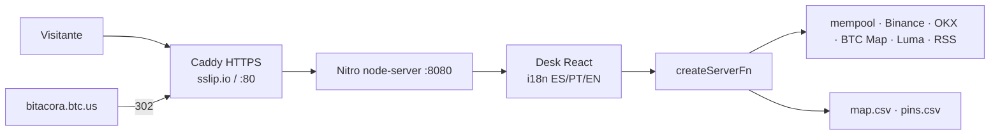

# Informe: textos, funcionamiento y testeo

Fecha: 30 de agosto de 2026. Idiomas revisados: **ES · EN · PT**. Marca: **Consciencia Bitcoin**.

---

## 1. Gramática y ortografía (3 idiomas)

Se unificó el tono y se corrigieron calcos. Las **415 claves** de UI coinciden en ES, EN y PT (ninguna clave huérfana).

### Español (voseo rioplatense)

| Antes | Ahora |
|---|---|
| Cerca de ti / cerca de ti | Cerca de vos |
| Si deseas contribuir | Si deseás contribuir |
| Descubre / Encuentra / Suma / lideras | Descubrí / Encontrá / Sumá / liderás |
| Publicálo | Publicalo |
| “hasta verificar o cancelar” | El flujo ya no tiene Cancelar: “hasta verificar” |
| Pin: “arga tú comunidad…” | “Cargá tu comunidad o comercio bitcoiner a Bitácora…” |

El bloque Consciencia usaba tuteo (“Descubre”, “Si lideras”) y el resto del sitio voseo. Quedó voseo.

### English

Ajustes de consistencia: pin flow without “cancel”; proof URL “not Instagram”; same CARGA-XXXX code name as ES/PT.

### Português

| Antes | Ahora | Por qué |
|---|---|---|
| Pedir pino / pinos | Pedir pin / pins | “Pino” suena a chincheta, no al anuncio |
| O que você quer… | O que queres partilhar… | El resto del PT es tuteo (tu/teu), no você |
| Confirme que não é um bot | Confirma que não és um bot | Concordancia con tu |
| tender uma ponte | lançar uma ponte | Calco del español “tender” |

El PT sigue siendo **europeu com vocabulário latino-americano** (Bitcoin, sats, bitácora), no brasileño puro: coherente con el selector PT único.

### Contenido verificado

- Marca **Consciencia Bitcoin** (con s) en menú, pie, SEO, CSV, contacto y LABIF.
- Logo file `/logos/conciencia-bitcoin.png` y ancla `#conciencia` se mantienen para no romper URLs.
- Instagram **no** es URL de prueba: el scraper no lee bios (login wall).
- Código de anuncio: `CARGA-XXXXXX` (se aceptan `BIT-` viejos).

---

## 2. Funcionamiento (cómo está armada la bitácora)



**Qué hace cada sección**

| # | Sección | Qué hace | De dónde salen los datos |
|---|---|---|---|
| 1 | Mapa | Globo 3D (primera visita) → Leaflet 2D. Comercios, comunidades, GPS, alta con captcha. **Sumate aquí** pide ubicación y centra la ciudad. | BTC Map API + `public/data/map.csv` + GPS del navegador (no IP, salvo fallback) |
| 2 | Consciencia Bitcoin | Relato, propósito, LATAM Cripto Mom | Copy estática i18n |
| 3 | Roadmap Web3 | Fases Q1–Q4 hasta el halving, en lenguaje simple | Copy estática |
| 4 | Comunidad y Networking | Anuncios (pins 7 días) + eventos + feed | pins.csv + Luma/calendarios + Stacker News |
| 5 | Pulso hoy | Titulares, traducción al idioma del navegador | RSS + API de traducción |
| 6 | Historia | Hitos con CTA (white paper, PizzaDAO, etc.) | Copy + enlaces verificados |
| 7 | Red | Hashrate, fees, mempool | mempool.space |
| 8 | Mercado | Velas 1D/1S/1M/6M, EMAs, heatmap 10 exchanges, POC semanal, ETF, CLARITY/Polymarket | Binance/OKX/HL + modelo de liquidaciones |

**Anuncios (pins)**  
1. Formulario + captcha.  
2. Pantalla **Generando PIN…**  
3. Código `CARGA-XXXXXX` se copia al portapapeles. Un botón: **Ya cargué la prueba**.  
4. El pin aparece **pendiente** en el tablero; iconos naranja solo de las redes cargadas.  
5. El scraper busca el código en web/X/Nostr (no Instagram). Si está, vive 7 días.

**Soberanía**  
Sin cuentas, sin KYC para leer, sin cookies de ads. Contacto por formulario (el mail no se publica). Host: VPS Njalla + Caddy. Puerta BNS: `https://bitacora.btc.us` → 302 a `https://45.158.116.49.sslip.io`.

---

## 3. Testeo general (30 ago 2026)

### Lo que sí anda (comprobado ahora)

| Prueba | Resultado |
|---|---|
| `https://45.158.116.49.sslip.io` | HTTPS 200, TTFB ~0,5 s, HTML Bitácora |
| `https://bitacora.btc.us` | 302 → sslip.io (candado después del salto) |
| JS principal `/assets/index-*.js` | 200 |
| `map.csv` | 200 (overlay propio) |
| `robots.txt` / `sitemap.xml` | 200 |
| i18n ES/EN/PT | 415 claves, 0 faltantes |
| Repo GitHub `main` | Incluye Consciencia, CARGA-, geojson local, pins UX |

### Huecos (el VPS no está al día con `main`)

El servidor público **todavía sirve un build anterior**. Por eso:

| Prueba | En `main` (repo) | En el VPS hoy |
|---|---|---|
| `/data/ne-110m-countries.json` (globo sin jsDelivr) | Existe | **404** |
| `/data/pins.csv` con Consciencia / “Cargá…” | Con contenido | **Vacío** (solo header) |
| Teselas OSM (sin “API KEY REQUIRED” de Carto) | OSM + fallback Esri | Depende del JS viejo |
| Generando PIN / CARGA- / no Instagram | En código | No desplegado |
| Iconos sociales chicos sin disco | En código | No desplegado |

Hasta que no corran en el VPS:

```bash
git -C /tmp/bitacora-src pull
bash /tmp/bitacora-src/deploy/bootstrap.sh
```

el visitante **no ve** globo local, pines nuevos ni las correcciones de copy.

### Matriz funcional (código vs. producción)

| Flujo | Código | Producción | Nota |
|---|---|---|---|
| Globo → mapa | OK | Frágil | GeoJSON remoto o 404 local |
| Sumate aquí + GPS | OK | Si el JS viejo no lo tiene | Pedir permiso del navegador (HTTPS sí) |
| Alta comercio/comunidad | OK | OK si el build viejo | Captcha + CSV |
| Anuncios verificar | OK (no IG) | Pins vacíos en estático | Escribir pins.csv en `/var/www/bitacora/public/data/` |
| Contacto | FormSubmit | Depende de casilla activada | El mail no se muestra |
| Mercado / velas / POC | OK | OK si el bundle viejo | POC semanal no debe moverse con zoom |
| ES/PT/EN | Completo | Bundle viejo = textos viejos (“Conciencia”, “BIT-”) | |

### Accesibilidad (revisión rápida)

- `skipToContent`, `aria-live` en Generando PIN y “código copiado”.
- Captcha con botón tipo `button` (no envía el form).
- QR: clic amplía / clic achica.
- Menú visible; idioma ES PT EN arriba a la derecha.
- Pendiente: contraste de iconos naranja sobre blanco (pasa); el globo blanco-en-blanco sigue siendo difícil de “ver” si WebGL tarda — por eso existe **Entrar al mapa**.

---

## 4. Recomendación inmediata

1. **Desplegar `main` en el VPS** (pull + bootstrap). Sin eso, el informe de copy y de pins no se ve en bitacora.btc.us.  
2. Probar en ventana privada: globo → Sumate aquí → mapa Montevideo/Colonia; Anuncios con URL **lnk.bio o X** (no Instagram).  
3. Si el pin Consciencia debe verse ya: copiar `public/data/pins.csv` del repo a `/var/www/bitacora/public/data/pins.csv` y restart.

No es un certificado de conformidad (RGPD/EAA). Es el estado real del producto y del servidor al 30/08/2026.
